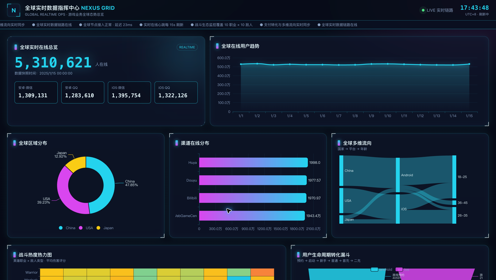
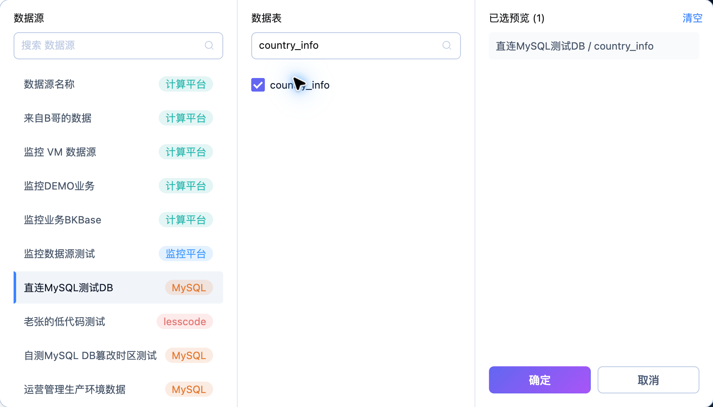
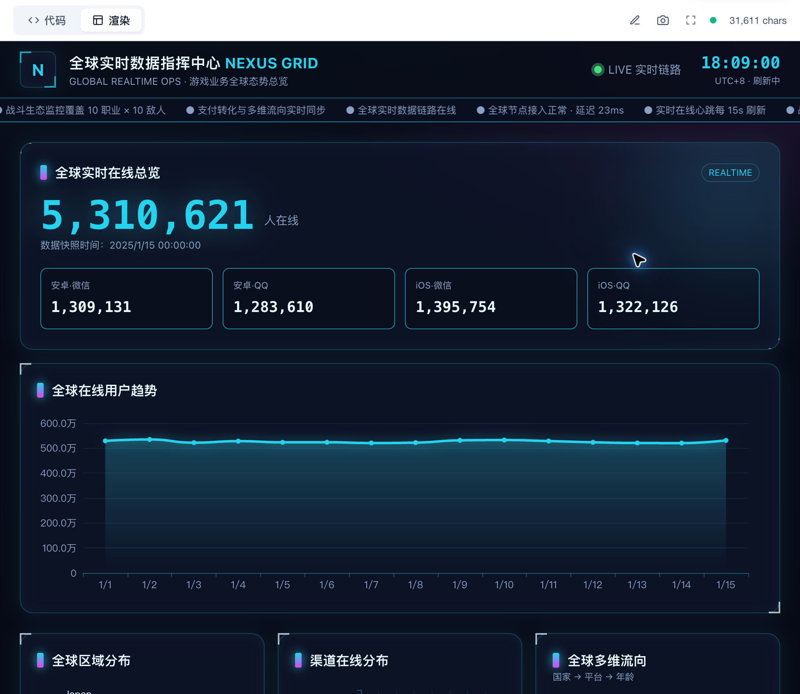

# AI 报告

AI 报告基于所选数据和自然语言需求组织 HTML 分析页面，提供代码编辑与渲染查看。本页使用 **全球实时数据指挥中心 · NEXUS GRID**。

## 查看正式报告

在“AI报告”列表选择报告，核对正式或草稿状态。正式报告提供访问链接，可查看 HTML 内容；草稿用于继续编辑。

示例包含在线总览、用户趋势、区域分布、流向、热力图和转化漏斗。标题中的“实时”不能代替数据时效判断，应核对页面显示的快照时间及查询来源。

## 选择分析数据

1. 从列表单击“新建报告”，或进入已有报告的编辑页。
2. 单击“添加数据表”，先选择数据源，再按实际表名搜索并选择数据表。
3. 确认所选范围后，描述分析问题、指标、维度、过滤条件和输出要求。
4. 按需要选择“设计风格”，提交需求并查看生成内容。

示例选表入口中，“直连MySQL测试DB”的国家画像物理表名为 `country_info`；逻辑数据集的中文显示名与物理表名应分别核对。这里用于说明选表操作，不表示已有 NEXUS GRID 报告使用该表。

## 编辑、渲染与保存

编辑页通过“代码”和“渲染”切换内容。核对 HTML、图表和业务文字，渲染后检查布局、数据与交互；确认内容后单击“保存报告”。需要业务访问时，再从列表核对正式状态与访问链接。

生成或修改后，必须检查关键数值、统计范围、聚合口径与结论依据。AI 输出不能替代业务数据校验。相关方法见[使用 AI 报告分析业务数据](../../Best-Practices/AI-business-analysis.md)。
