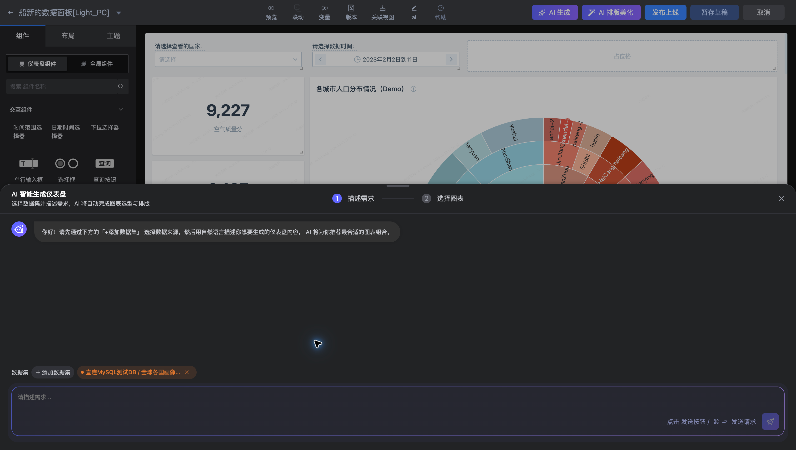
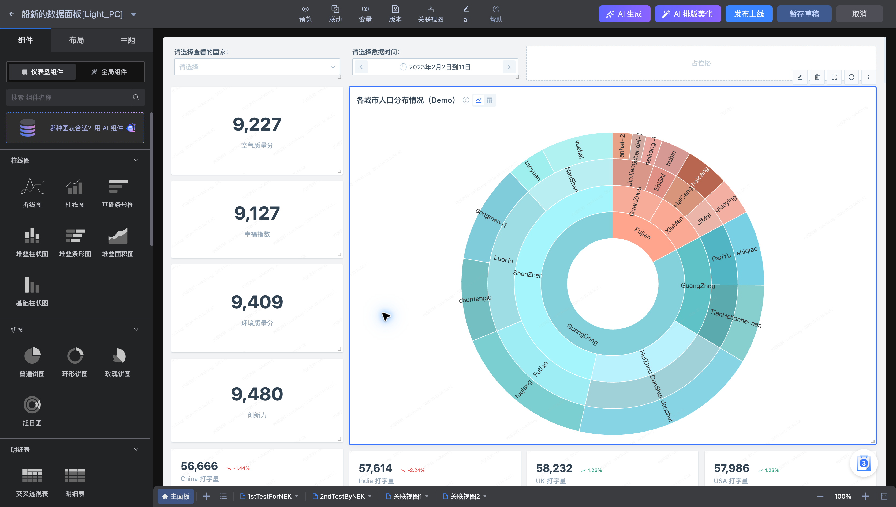

# AI 生成仪表盘

AI 生成通过所选数据集和自然语言需求完成图表选型与排版。入口位于仪表盘编辑工具栏。

## 生成流程

1. 在编辑页点击“AI 生成”。
2. 点击“添加数据集”，选择需求涉及的数据集。
3. 描述分析目标、指标、维度、时间范围与希望看到的图表。
4. 进入“选择图表”步骤，检查生成建议并选择需要的内容。
5. 回到画布后，核对查询结果、图表口径和布局，再预览并发布。

需求描述示例：

> 按国家比较空气质量、幸福指数和创新力，展示各指标的总览，并提供国家筛选。给出一张国家对比条形图和指标总览卡片。

示例需求应与所选数据集实际字段相符。生成后仍需确认字段、聚合方式和过滤条件，AI 输出不能替代业务口径核对。

“AI 排版美化”用于已有画布的布局调整。调整后检查组件位置、大小和筛选器可用性。
