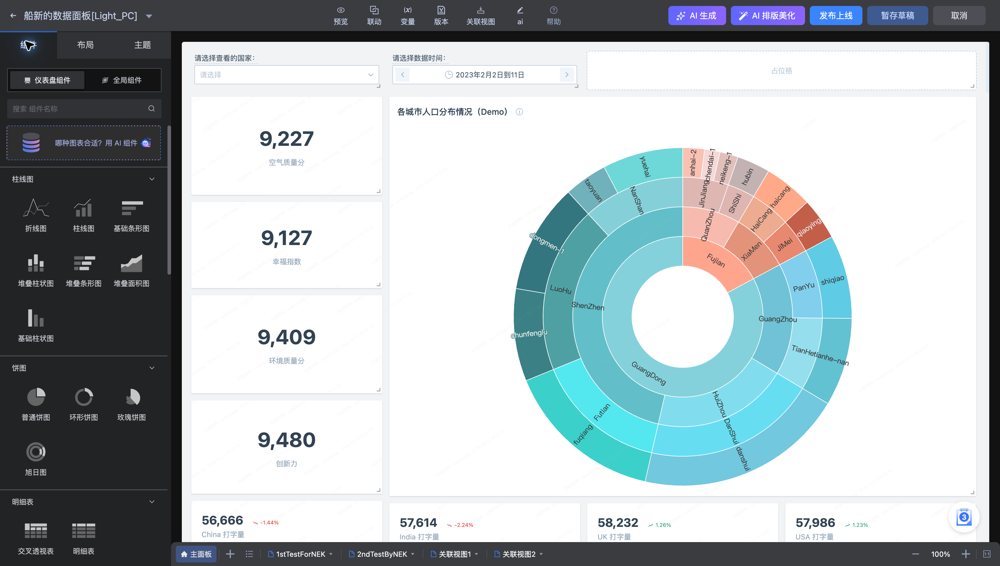
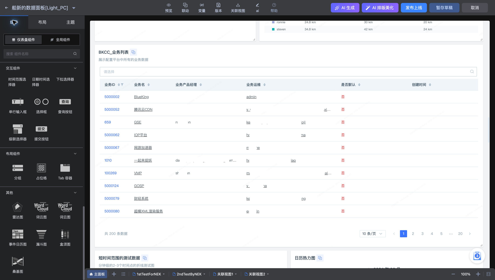

# 图表组件分类及适用描述

**船新的数据面板[Light_PC]** 的编辑页提供图表、交互、布局与多媒体组件。选择组件前，先明确分析问题和数据结构。

## 选择数据图表

| 分类 | 常用组件 | 适用问题 |
| --- | --- | --- |
| 柱线图 | 柱状图、条形图、折线图、柱线图、堆叠图 | 分类比较、时间趋势与构成变化 |
| 饼图 | 普通饼图、环形图、玫瑰图、旭日图 | 占比与层级构成；类别宜少 |
| 表格 | 明细表、交叉透视表 | 查看明细与多维汇总 |
| 指标卡 | 数字面板、数字与趋势线、仪表盘 | 总览关键指标与目标进度 |
| 热力图 | 热力图、日历热力图 | 两维密度或每日变化 |
| 地图 | 世界地图 | 匹配地理维度的区域分布 |
| 其他 | 雷达、词云、事件日历、漏斗、盒须、桑基图 | 多指标画像、文本频次、事件、转化、分布与路径 |

## 配置交互与排版

| 分类 | 组件 | 用途 |
| --- | --- | --- |
| 交互组件 | 时间范围、日期时间、下拉、单行输入、选择框、查询按钮、级联、提交按钮 | 输入查询条件或触发操作 |
| 布局组件 | 分组、占位格、Tab 容器 | 组织画布结构 |
| 多媒体 | Markdown、富文本、图片、网页 | 补充业务说明与展示内容 |

## 检查数据要求

选择图表后，配置页会提示指标和维度的要求。桑基图需要一个指标、至少两个维度；路径数据还需核对源、目标和循环处理。地图应核对地理名称，时间图应使用正确的时间字段与粒度。

图表类型满足要求后，再设置聚合、排序、限制和过滤。不要通过更换图表类型掩盖数据口径问题。操作见[图表配置](Chart-Configuration.md)。
