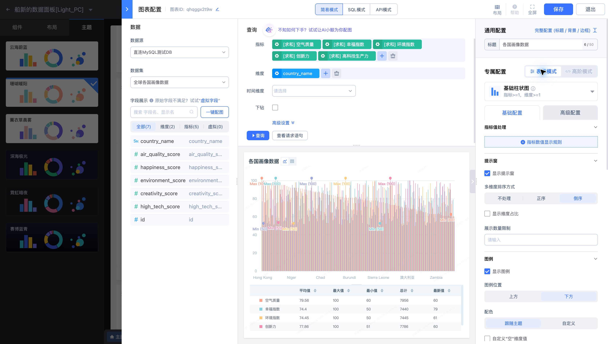
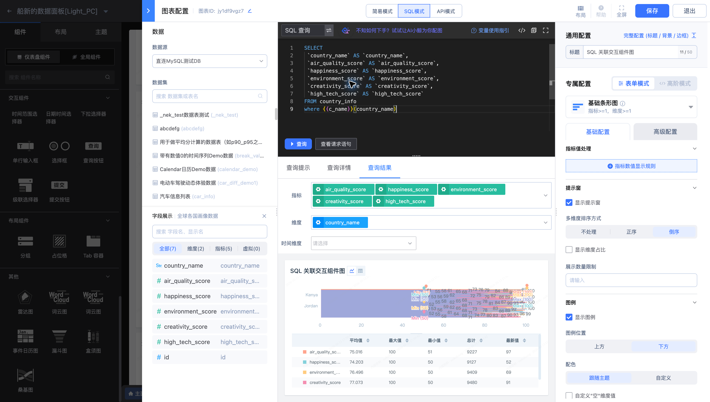
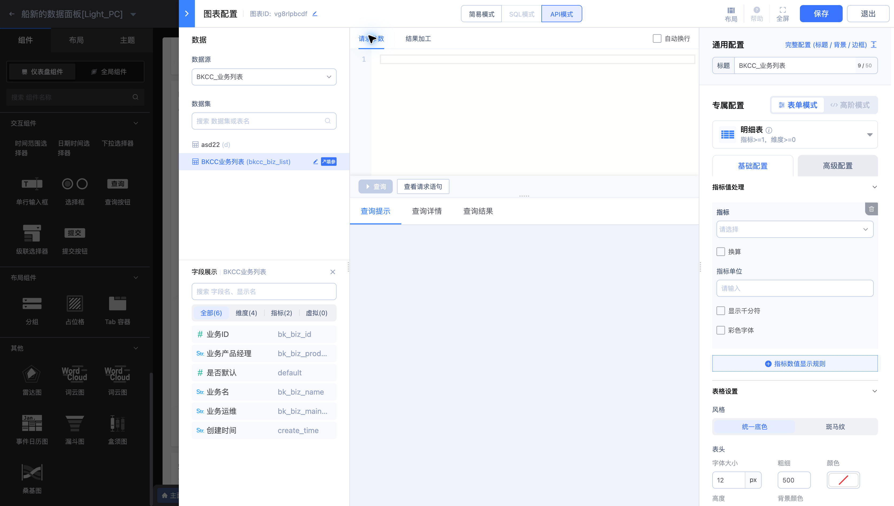
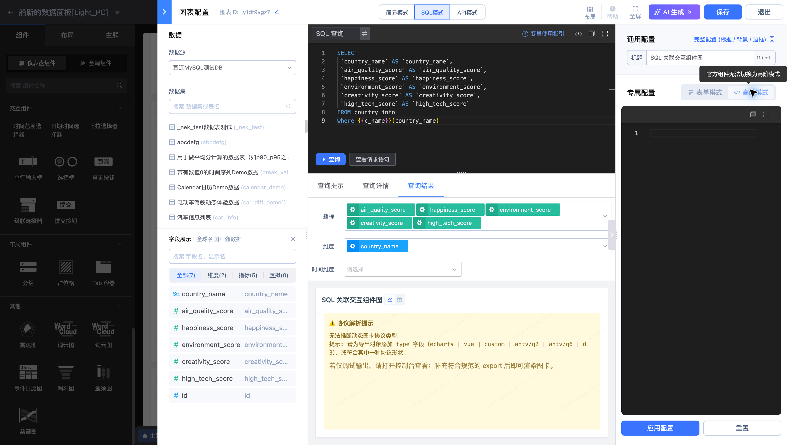

# 图表配置

在 **船新的数据面板[Light_PC]** 的编辑页选中图表，单击浮动工具栏的编辑图标，配置查询和展示。查询方式与可用组件由数据来源和图表类型决定。

## 简易模式

示例“各国画像数据”使用“直连MySQL测试DB → 全球各国画像数据”。添加五个分值指标，以 `country_name` 作为维度，通过求和聚合比较国家。

| 配置 | 用途 |
| --- | --- |
| 指标与聚合 | 定义计算字段和求和、平均等处理方式 |
| 维度 | 定义分组字段 |
| 下钻 | 按配置的维度层级进一步分析 |
| 过滤 | 限定数据范围 |
| 排序与限制 | 控制结果顺序与返回数量 |

设置后单击“查询”，核对结果与图表要求。字段显示名用于阅读，查询字段名以数据集定义为准。

## SQL 模式

示例“SQL 关联交互组件图”从 `country_info` 查询国家和五个分值，使用 `{{c_name}}(country_name)` 作为国家过滤条件。

在 SQL 编辑器输入查询，按“变量使用指引”配置变量。条件宏、内置变量及处理方法的完整写法见[变量类型、作用域与方法参考](Variables-and-methods.md)。查询完成后，将返回字段映射为指标与维度，核对查询提示、详情和结果。改变 SQL 或参数后重新查询，避免沿用旧结果。

## API 模式

图中展示同一仪表盘内“BKCC_业务列表”图表切换后的 API 配置入口，请求参数尚未填写。选择已接入的接口数据源与数据集，按接口配置请求参数和结果加工，再查询并映射返回字段。与数据库 SQL 查询相比，API 模式需要特别核对接口的参数、分页和返回结构。

已有图表切换查询模式可能清空配置。切换前保存版本，并核对提示；需要保留原图时，可先创建独立图表。

## 样式与高阶配置

表单模式按组件提供标题、图例、配色、提示窗、坐标轴、背景和边框等设置。先完成数据查询，再调整样式；常驻值与最大/最小值标识应与业务口径一致。

高阶模式用于支持该能力的组件，通过代码维护展示配置。根据编辑器的组件协议与提示填写类型及配置，预览后检查数据绑定、交互和尺寸。官方组件可能限制切换；遇到限制提示时使用表单模式，或选择支持高阶配置的组件。不要将空白或协议不完整的代码应用到现有图表。

保存图表后，返回画布预览，再按[编辑模式](Edit-Mode.md)保存草稿或发布。
