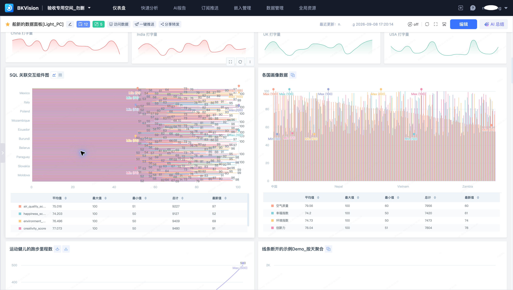

# 仪表盘

仪表盘将图表、筛选器和说明组件组合为可交互的画布。本页以 **船新的数据面板[Light_PC]** 为例。

![船新的数据面板[Light_PC]](../../Media/Dashboard/Dashboard-Light-PC-01-overview.png)

## 浏览与查询

1. 在空间内打开“仪表盘”，选择目标目录和仪表盘。
2. 设置页面中的国家、时间等筛选条件。
3. 查看各组件的查询结果。图表上的图形与表格切换入口可用于核对数据。

统计区域可以展示平均值、最大值、最小值、总计和最新值。核对数值时，应同时确认筛选条件、聚合方式和时间范围。

## 编辑与交互

- [编辑模式](Edit-Mode.md)：添加组件、调整布局并发布。
- [图表配置](Chart-Configuration.md)：选择数据查询方式和展示配置。
- [联动与关联视图](Linkage-and-related-views.md)：从图表进一步分析数据。
- [仪表盘变量](Variables.md)：为查询和展示提供参数。
- [版本与主题](Versions-and-themes.md)：管理配置版本和视觉样式。

删除仪表盘前，应检查订阅、嵌入等引用关系；删除操作应由资源负责人确认后执行。
