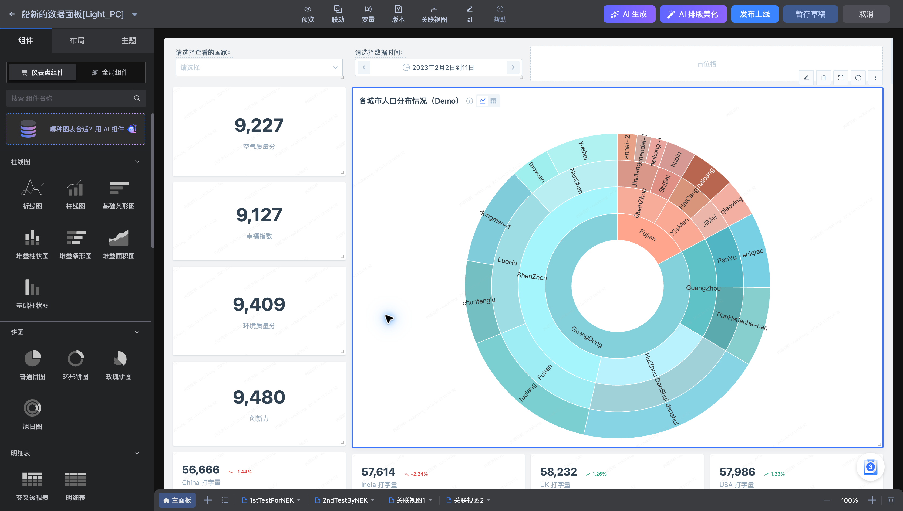
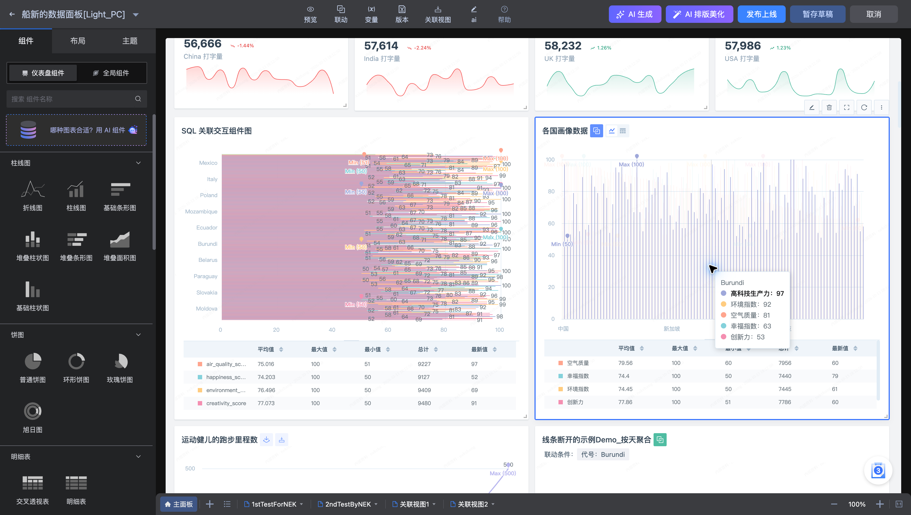

# 编辑模式

打开 **船新的数据面板[Light_PC]** 的编辑入口，可在画布中维护组件和布局。编辑页默认打开最近一次草稿，浏览页显示正式版本。

## 添加与排列组件

1. 在左侧“组件”中选择需要的图表、交互或多媒体组件。
2. 将组件放到画布中，拖动位置并调整大小。
3. 选中组件，使用浮动工具栏的编辑入口配置数据与样式。
4. 使用分组、占位格、Tab 容器组织页面，预览整体效果。

组件工具栏也包含删除入口。删除前请核对被选中的组件以及其变量、联动引用。

## 保存和发布

| 操作 | 使用时机 |
| --- | --- |
| 预览 | 检查布局、筛选条件和交互效果 |
| 暂存草稿 | 保留编辑进度，之后继续修改 |
| 发布上线 | 将确认后的配置用于正式浏览 |
| 取消 | 离开本次编辑 |

发布前应检查每个图表是否能查询成功，变量默认值是否符合预期，联动和关联视图是否指向正确对象。更多历史版本操作见[版本与主题](Versions-and-themes.md)。
