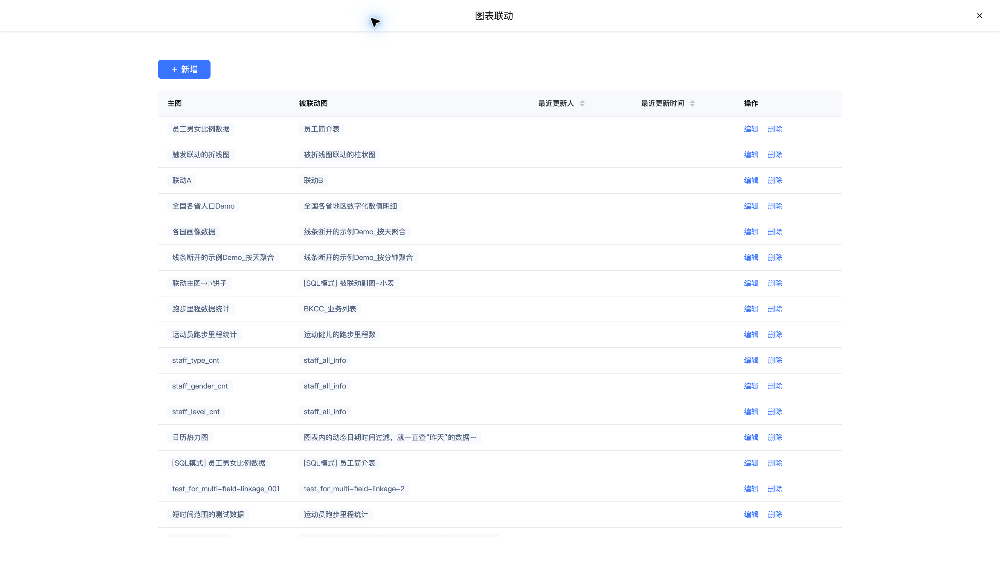
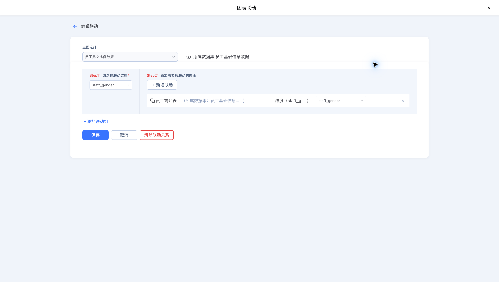
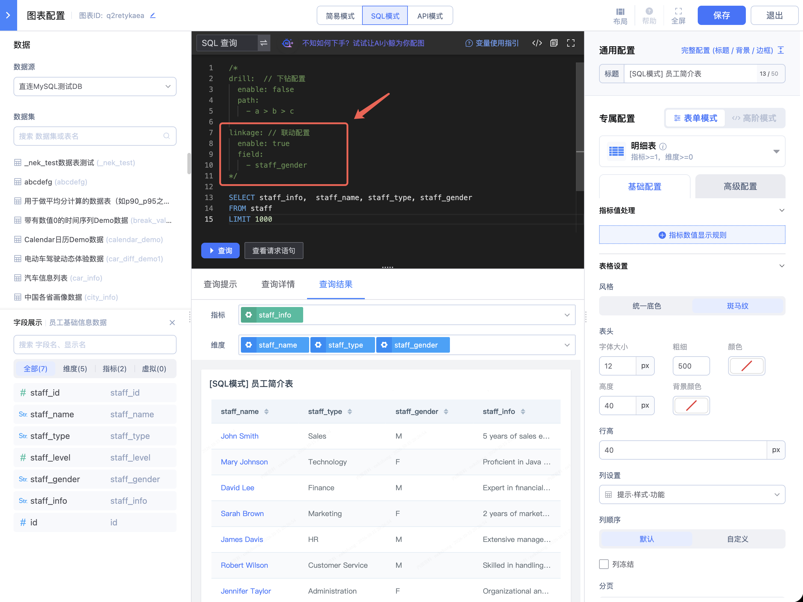
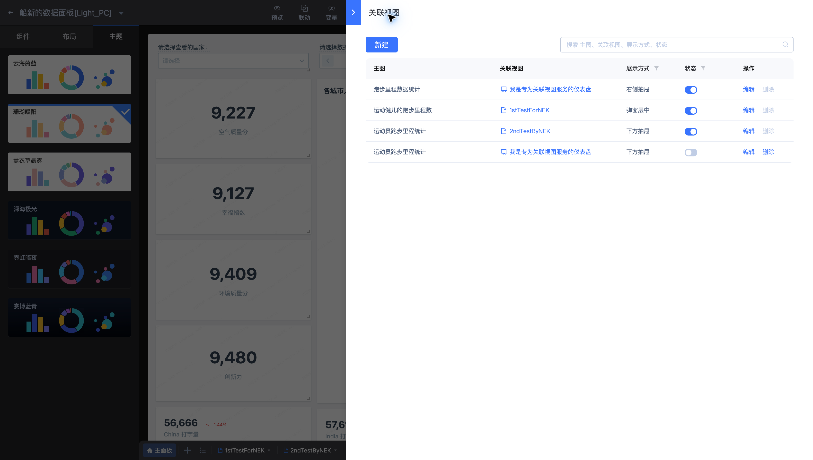

# 联动与关联视图

联动用于筛选其他图表；关联视图用于打开一个补充分析面板。本页所有配置均来自 **船新的数据面板[Light_PC]**。

## 配置图表联动

1. 在编辑工具栏打开“联动”，新增或编辑规则。
2. 选择主图与触发联动的维度。
3. 添加被联动图，配置其维度与主图字段的对应关系。
4. 保存规则后，在预览中点击主图数据，检查被联动图的结果。

示例规则以“员工男女比例数据”为主图，将 `staff_gender` 传给“员工简介表”的同名维度。映射前要确认两侧字段的数据类型与值域一致。

如果是SQL图表，想要让其他图可以联动，需要在SQL语句中声明 linkage 的 field （如图）

## 配置关联视图

在工具栏打开“关联视图”，设置来源图表、目标视图与打开方式。示例中，“运动健儿的跑步里程数”打开 `1stTestForNEK`，打开方式为弹窗层；其他规则使用右侧或下方抽屉。

配置完成后，从来源图表触发入口，核对目标视图、参数及展示位置。移除规则前应确认业务流程不再依赖该入口。
