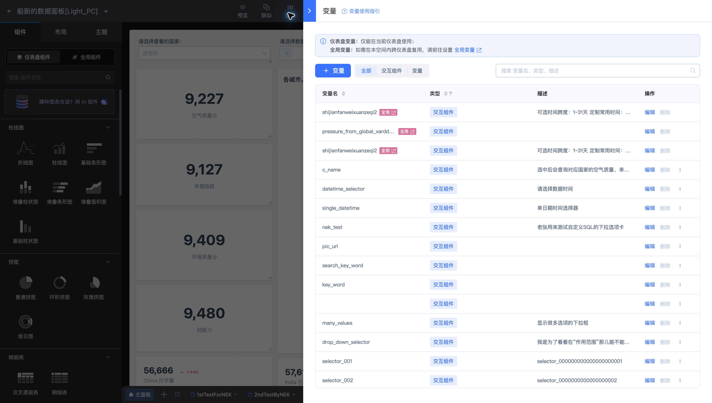
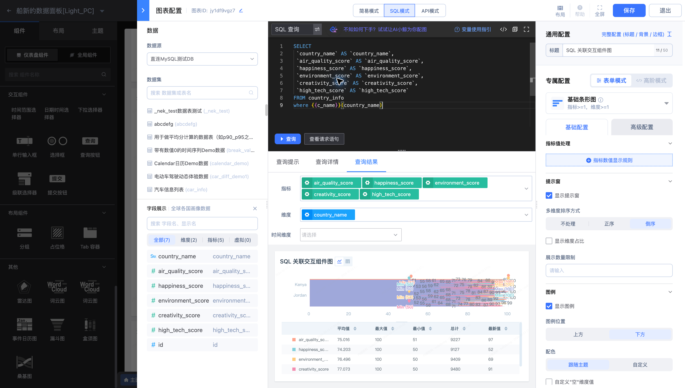
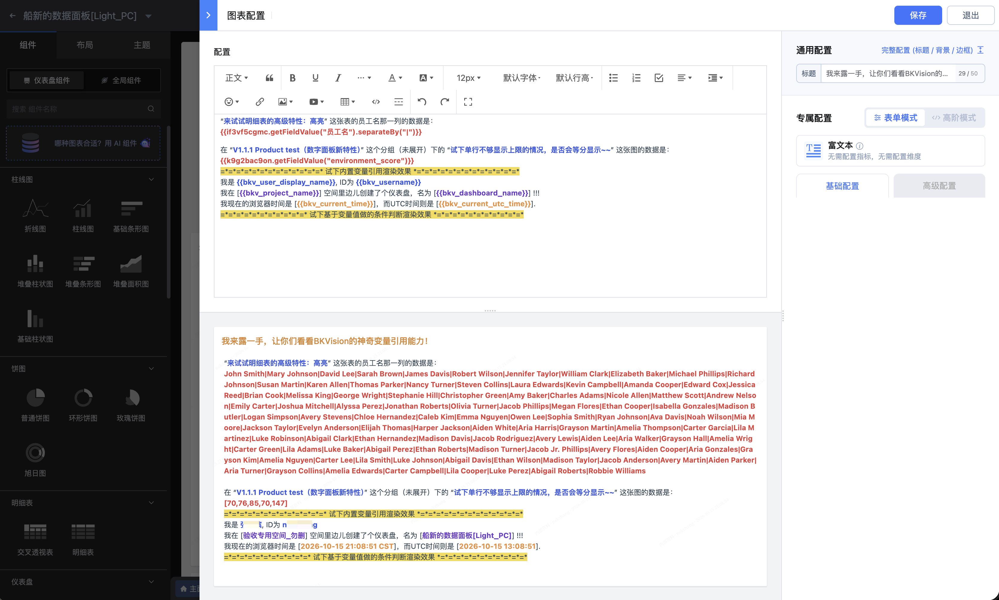

# 变量类型、作用域与方法参考

变量用于在仪表盘中复用参数、传递交互选择、引用图表数据，以及生成动态文字和查询条件。本页按变量来源、引用范围和处理方法说明写法；变量的创建与引用入口见[仪表盘变量](Variables.md)。

本页示例界面沿用 **船新的数据面板[Light_PC]**。语法中的 `var_name`、`chart_id` 和字段显示名是占位符，使用时替换为实际标识。



## 常用语法速查

| 需求 | 写法 | 含义 |
| --- | --- | --- |
| 输出常规变量或内置变量 | `{{var_name}}` | 将变量值输出为字符串 |
| 在 SQL 中生成匹配条件 | `{{var_name}}(field_name)` | 根据变量值生成 `=` 或 `IN` 条件 |
| 在 SQL 中生成排除条件 | `{{var_name}}(!field_name)` | 根据变量值生成 `!=` 或 `NOT IN` 条件 |
| 引用当前图表的字段值 | `${字段名}` | 用于图表内部支持字段引用的样式配置 |
| 提取某个图表的字段数据 | `{{chart_id.getFieldValue('字段显示名')}}` | 按图表 ID 和字段显示名取数 |
| 处理变量后输出 | `{{var_name.方法(参数)}}` | 先调用方法，再输出结果 |
| 在条件分支的输出中引用当前值 | `${value}` | 只在 `ifelse` 的输出模板中表示当前变量值 |
| 在级联输出模板中引用层级 | `${1}`、`${2}` | 在 `cascaderPrint` 的自定义模板中引用对应层级 |

`{{…}}` 是变量表达式；`${…}` 的含义取决于所在配置项。图表字段、条件输出和级联层级的占位符应分别使用，不能相互替换。

## 变量类型与来源

| 类型 | 来源或定义入口 | 引用方式 | 典型用途 |
| --- | --- | --- | --- |
| 常规变量 | 仪表盘的常量/变量定义、交互组件标识、图表 ID | `{{var_name}}`，并按来源选择方法 | 查询参数、动态文字、图表数据引用 |
| 图表变量 | 当前图表的维度或指标字段 | `${字段名}` | 在图表内部的样式配置中引用字段，例如明细表超链接 URL |
| 内置变量 | 平台提供，无需自行定义 | `{{变量名}}` | 读取用户、空间、仪表盘和交互触发点信息 |

变量类型、数据类型和复用范围分别描述不同属性：同一常规变量可能输出字符串、数组或对象；全局资源中维护的变量定义可在同一空间复用。内置变量的“全局”表示可在支持的仪表盘入口中引用，其值仍对应当前用户、当前空间或当前仪表盘。

### 常规变量可以用在哪里

| 来源 | 富文本内容 | 网页组件地址 | 支持 SQL 模式的查询语句 |
| --- | --- | --- | --- |
| 仪表盘常量/变量 | 支持 | 支持 | 支持 |
| 交互组件标识 | 支持 | 支持 | 支持 |
| 图表 ID | 支持 | 支持 | 不列入已支持范围 |

在支持变量的富文本内容或网页地址中插入 `{{var_name}}`，可以输出参数值；图表 ID 引用通常需要结合取数方法。组件标题、备注等其他输入项，应先检查该输入项是否提供变量支持。

图表内部的 `${字段名}` 仅获取当前图表的维度或指标字段值。它与通过图表 ID 提取一组字段数据的 `getFieldValue` 用途不同。

跨仪表盘复用定义见[全局变量](../Global-resources/Global-variables.md)与[全局交互组件](../Global-resources/Interactive-components.md)。

## SQL 条件写法



`{{var_name}}(field_name)` 表达的是一个完整的字段匹配条件。单值匹配对应 `=`，多值匹配对应 `IN`；字段名前加 `!` 时，对应 `!=` 或 `NOT IN`。

在 Light_PC 的“SQL 关联交互组件图”中，国家交互变量为 `c_name`，字段为 `country_name`：

```sql
WHERE {{c_name}}(country_name)
```

需要排除所选国家时，写法为：

```sql
WHERE {{c_name}}(!country_name)
```

使用条件宏时，不要再写成 `country_name = {{c_name}}(country_name)`。仅写 `{{c_name}}` 是直接输出变量值，与生成字段匹配条件的用途不同。

查询前检查变量输出是单值还是多值，并验证默认值、空值和多选状态。改变变量或查询后重新执行查询，使用“查看请求语句”和查询结果核对实际条件。

## 在富文本和Markdown中引用



如上图所示，可以在 富文本 或 Markdown编辑器 中使用变量引用图表数据，可用于数据的总结描述。

## 内置变量目录

内置变量无需新建。下表区分全局上下文与仪表盘交互上下文；标为“排期中”的项目不作为当前可用能力。

### 用户、空间、时间与仪表盘

| 变量名 | 含义 | 示例引用 | 状态 |
| --- | --- | --- | --- |
| `bkv_user_display_name` | 当前登录用户的显示名，例如“张三” | `{{bkv_user_display_name}}` | 已支持 |
| `bkv_username` | 当前登录用户 ID/英文账号，例如 `sanzhang` | `{{bkv_username}}` | 已支持 |
| `bkv_user_org` | 当前登录用户的组织架构信息，例如 BG、部门、中心路径 | `{{bkv_user_org}}` | 排期中 |
| `bkv_project_id` | 当前空间 ID | `{{bkv_project_id}}` | 已支持 |
| `bkv_project_name` | 当前空间名称 | `{{bkv_project_name}}` | 已支持 |
| `bkv_current_time` | 当前日期时间，带时区偏移 | `{{bkv_current_time}}` | 已支持 |
| `bkv_current_utc_time` | 当前 UTC 0 时区日期时间 | `{{bkv_current_utc_time}}` | 已支持 |
| `bkv_dashboard_id` | 当前仪表盘 ID | `{{bkv_dashboard_id}}` | 已支持 |
| `bkv_dashboard_name` | 当前仪表盘名称 | `{{bkv_dashboard_name}}` | 已支持 |

时间值用于查询、显示或推送时，应统一统计时区。`bkv_current_time` 与 `bkv_current_utc_time` 的时间口径应分别核对，不能只比较字符串是否相同。

### 联动与关联视图的触发点

以下变量作用于仪表盘交互上下文，用于引用用户在主图点击的数据点。四项均已支持。

| 变量名 | 含义 | 引用写法 |
| --- | --- | --- |
| `trigger_point` | 被点击的数据点对象 | `{{trigger_point}}` |
| `trigger_point_label` | 被点击数据点的维度显示名 | `{{trigger_point_label}}` |
| `trigger_point_name` | 被点击数据点的维度值 | `{{trigger_point_name}}` |
| `trigger_point_value` | 被点击数据点的指标值 | `{{trigger_point_value}}` |

`label`、`name` 和 `value` 分别描述显示名、维度值和指标值。配置后应通过实际点击主图数据点，核对传给目标图表或视图的内容。不要用缺少点击上下文的初始状态判断触发值。

规则设置见[联动与关联视图](Linkage-and-related-views.md)。

## 方法概览

方法分为提取数据和处理输出两类。先确认变量来源和输出结构，再选择方法；链式调用时，前一步的输出应满足后一步的输入要求。

| 方法 | 分类 | 处理对象 → 输出 | 状态 |
| --- | --- | --- | --- |
| `getFieldValue('字段显示名')` | 提取数据 | 指定图表 → 字段数据，示例为数组 | 已支持 |
| `getCheckedFieldValue('字段显示名')` | 提取数据 | 明细表已勾选行 → 对应字段数据，示例为数组 | 已支持 |
| `format('格式串')` | 输出处理 | 时间类型字段值 → 格式化字符串 | 已支持 |
| `separateBy('分隔符')` | 输出处理 | 数组 → 字符串 | 已支持 |
| `index(n)` | 输出处理 | 数组 → 指定位置的值，按字符串输出 | 已支持 |
| `key('键名')` | 输出处理 | KV 对象 → 指定键的值，按字符串输出 | 已支持 |
| `slice(x, y)` | 输出处理 | 字符串 → 截取后的字符串 | 已支持 |
| `ifelse(...)` | 输出处理 | 当前变量值 → 条件分支的输出字符串 | 已支持 |
| `cascaderPrint(...)` | 输出处理 | 级联选择器对象 → 按层级组织的输出 | 已支持 |
| `split(separator, limit)` | 输出处理 | 字符串 → 数组 | 规划中 |
| `max()` | 输出处理 | 数组 → 最大数值 | 规划中 |
| `min()` | 输出处理 | 数组 → 最小数值 | 规划中 |
| `avg()` | 输出处理 | 数组 → 平均数值 | 规划中 |

具有明确编辑模式支持说明的方法如下。方法本身的模式支持不自动扩大其变量来源的引用范围。

| 方法 | 已列明支持的编辑模式 |
| --- | --- |
| `format` | SQL、API、表单 |
| `separateBy`、`index`、`cascaderPrint` | SQL、API |

## 提取图表数据

### 获取图表某字段的数据

```text
{{chart_id.getFieldValue('字段显示名')}}
```

参数使用**图表中字段的显示名**，不是字段 ID。同一原始字段可能配置成不同聚合指标，应以最终显示名区分。

例如，返回字段数据为：

```json
["0", "1", "2", "3", "4"]
```

需要拼成文字或提取单个位置时，可继续使用 `separateBy` 或 `index`。

### 获取明细表勾选行的数据

```text
{{chart_id.getCheckedFieldValue('字段显示名')}}
```

该方法读取明细表**已勾选行**中对应字段的数据。示例中勾选三行后，输出可为：

```json
["0", "1", "2"]
```

勾选取数与读取全部图表字段数据用途不同。使用前检查表格勾选状态、字段显示名和实际输出。

## 处理数组、对象和字符串

### 使用 separateBy 拼接数组

```text
{{chart_id.getFieldValue('字段显示名').separateBy('|')}}
```

当字段数据为 `["0", "1", "2", "3", "4"]` 时，输出为 `0|1|2|3|4`。分隔符可以使用任意字符串。

拼接结果是字符串；若后续处理需要数组，应保留提取出的数组结构。

### 使用 index 提取数组元素

```text
{{chart_id.getFieldValue('字段显示名').index(0)}}
{{chart_id.getFieldValue('字段显示名').index(-1)}}
```

索引从 `0` 开始，支持负整数。对 `["0", "1", "2", "3", "4"]`，`index(0)` 输出 `0`，`index(-1)` 输出 `4`。使用负索引时，从数组末尾定位。

### 使用 key 读取对象属性

```text
{{var_name.key('label')}}
```

当变量是 `{"label":"一","value":"1"}` 这样的 KV 对象时，以上表达式输出 `一`。先核对变量是对象还是数组，再按实际键名取值。

### 使用 slice 截取字符串

```text
{{var_name.slice(0,4)}}
```

`x` 和 `y` 用于指定截取区间，输入和输出均为字符串。配置后应检查首尾字符与预期长度，尤其要核对结束位置和单参数调用的实际效果。

## 格式化时间

`format` 只用于时间类型字段数据的格式化。先确认变量值的时间类型，再选择格式参数。

```text
{{var_name.format('%Y-%m-%d %H:%M:%S')}}
{{var_name.format('%s')}}
{{var_name.format('%ss')}}
```

第一种写法输出年、月、日、时、分、秒，例如 `2023-12-12 23:00:01`；后两种分别输出秒级、毫秒级时间戳。

| 参数 | 含义 | 示例或范围 |
| --- | --- | --- |
| `%Y` | 四位年份 | `2022` |
| `%y` | 两位年份 | `22` |
| `%m` | 两位月份 | `07` |
| `%b`、`%h` | 英文月份简写 | `Jul` |
| `%B` | 英文月份全称 | `July` |
| `%d` | 两位日期 | `31` |
| `%A` | 星期全称 | `Saturday` |
| `%a` | 星期简写 | `Sat` |
| `%H` | 24 小时制小时 | `00`–`23` |
| `%I` | 12 小时制小时 | `01`–`12` |
| `%M` | 分钟 | `00`–`59` |
| `%S` | 秒 | `00`–`60`，`60` 为闰秒 |
| `%s` | 秒级时间戳 | 用于要求秒级时间的接口或查询 |
| `%ss` | 毫秒级时间戳 | 用于要求毫秒级时间的接口或查询 |
| `%p` | 上午/下午指示符 | `AM`、`PM` |
| `%Z` | 时区名称 | `CST` |
| `%z` | 时区偏移 | `+0800` |

注意 `%m` 表示月份，`%M` 表示分钟；`%s` 和 `%ss` 的单位不同。输出时间戳前先确认目标查询或接口要求的单位。

## 使用 ifelse 输出条件文案

`ifelse` 根据当前变量值判断条件，并输出相应字符串。基本结构为：

```text
{{var_name.ifelse(if{条件, "命中时的输出"}, else{"未命中时的输出"})}}
```

在输出字符串中使用 `${value}`，可插入当前变量值。例如：

```text
{{var_name.ifelse(if{compare(eq, "Tencent"), "所属公司：${value}"}, else{"其他公司"})}}
```

### 支持的条件

| 条件 | 含义 | 条件片段示例 |
| --- | --- | --- |
| `compare(eq, 值)` | 等于；比较数字或字符串 | `compare(eq, "Tencent")` |
| `compare(ne, 值)` | 不等于；比较数字或字符串 | `compare(ne, 10)` |
| `compare(gt, 数字)` | 大于 | `compare(gt, 50)` |
| `compare(lt, 数字)` | 小于 | `compare(lt, 100)` |
| `like("文本")` | 模糊匹配 | `like("kin")` |
| `in("值1", "值2", ...)` | 匹配给定值范围 | `in("a", "b", "c")` |
| `notin("值1", "值2", ...)` | 不匹配给定值范围 | `notin("D", "E")` |
| `isnull()` | 为空 | `isnull()` |
| `isnotnull()` | 不为空 | `isnotnull()` |
| `regex("表达式")` | 正则匹配 | 见下方示例 |

正则条件片段：

```text
if{regex("/^_[a-zA-Z]*\d+$/"), "匹配指定标识"}
```

该示例的匹配文本可为 `_Demo001`。使用比较或匹配条件时，应核对变量的数据类型、大小写和空值；不要把条件片段直接当作完整的变量表达式。

## 使用 cascaderPrint 处理级联选择值

级联选择器的输出包含层级信息。`cascaderPrint` 可以选择各层的显示文本或实际值，并按分隔符或自定义模板组织输出。

```text
{{var_name.cascaderPrint(label, all, '/')}}
{{var_name.cascaderPrint(value, custom, '国家 ${1} 的重点省份 ${2} 下，关键的城市是 ${3}')}}
```

| 参数位置 | 可选值 | 用途 |
| --- | --- | --- |
| 第一个参数 | `label`、`value` | `label` 取显示文本；`value` 取实际值 |
| 第二个参数 | `all`、`custom` | `all` 输出所选路径的全部层级；`custom` 使用自定义模板 |
| 第三个参数 | 分隔字符串或模板字符串 | `all` 时作为层级分隔符；`custom` 时定义单条路径的输出格式 |

`all` 示例会把每条选择路径组织为“第一层显示值/第二层显示值/…/第 n 层显示值”。`custom` 示例使用实际值，并通过 `${1}`、`${2}`、`${3}` 分别引用第一、第二、第三层。

参数之间使用英文逗号，字符串使用英文引号。按所需业务含义选择 `label` 或 `value`，不要用显示文本替代查询需要的实际值。

## 规划中的方法

以下方法列为规划中，不用于当前可用配置。写法仅说明其设计用途。

| 方法 | 用途与参数 | 参考写法 |
| --- | --- | --- |
| `split(separator, limit)` | 按分隔符拆分字符串；`limit` 可选，限制输出数组长度 | `{{var_name.split(',')}}` |
| `max()` | 取数组最大数值 | `{{chart_id.getFieldValue('字段显示名').max()}}` |
| `min()` | 取数组最小数值 | `{{chart_id.getFieldValue('字段显示名').min()}}` |
| `avg()` | 取数组平均数值 | `{{chart_id.getFieldValue('字段显示名').avg()}}` |

例如，`split(',')` 的设计用途是把 `a,b,c,d` 转成数组，再用于需要多值输入的配置。正式使用应以已发布能力为准。

## 配置后的检查

1. **标识一致：** 变量名、组件标识和图表 ID 指向预期对象；取图表字段时使用显示名。
2. **作用范围一致：** 在富文本、网页、SQL 或图表样式中使用各自支持的写法。
3. **类型一致：** 数组、对象、字符串和时间值与调用方法匹配；先检查原始输出，再增加链式处理。
4. **状态完整：** 覆盖默认值、空值、单选、多选、表格勾选和主图点击等实际使用状态。
5. **结果一致：** 核对动态文字、生成的查询条件及结果；订阅和嵌入还需检查各自传入的参数。

相关文档：[仪表盘变量](Variables.md)、[图表配置](Chart-Configuration.md)、[联动与关联视图](Linkage-and-related-views.md)、[全局变量](../Global-resources/Global-variables.md)。
