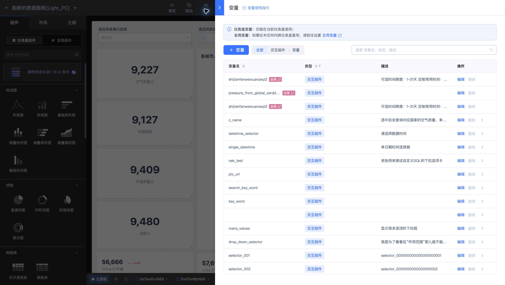

# 仪表盘变量

变量用于向查询和展示传入可变化的参数。本页以 **船新的数据面板[Light_PC]** 的 `c_name` 等变量为例。



需要查阅变量类型、引用范围、内置变量和方法语法时，参见[变量类型、作用域与方法参考](Variables-and-methods.md)。

## 选择作用范围

| 类型 | 作用范围 | 常见用途 |
| --- | --- | --- |
| 仪表盘变量 | 当前仪表盘 | 国家、时间等页面筛选条件 |
| 全局变量或组件引用 | 同一空间内复用 | 多个仪表盘共用的参数定义 |

## 配置与引用

1. 在编辑工具栏中打开“变量”。
2. 查看变量名称、说明、类型及当前配置；名称应能表达业务含义。
3. 为交互组件设置变量关联，使用户选择值传入图表查询。
4. 在查询中引用变量，使用“变量使用指引”核对当前类型的语法。

示例图表“SQL 关联交互组件图”使用以下条件：

```sql
where {{c_name}}(country_name)
```

这里的 `c_name` 用于按国家筛选。不要将不同类型变量的引用形式相互替换；查询前应检查默认值与空值处理。

修改变量后，通过[预览](Edit-Mode.md)验证初始状态和用户切换后的状态。跨仪表盘复用见[全局变量](../Global-resources/Global-variables.md)。
