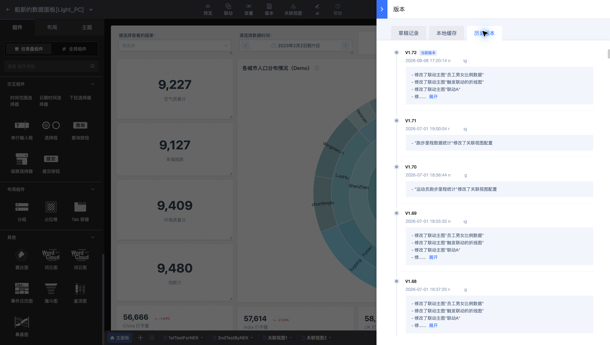
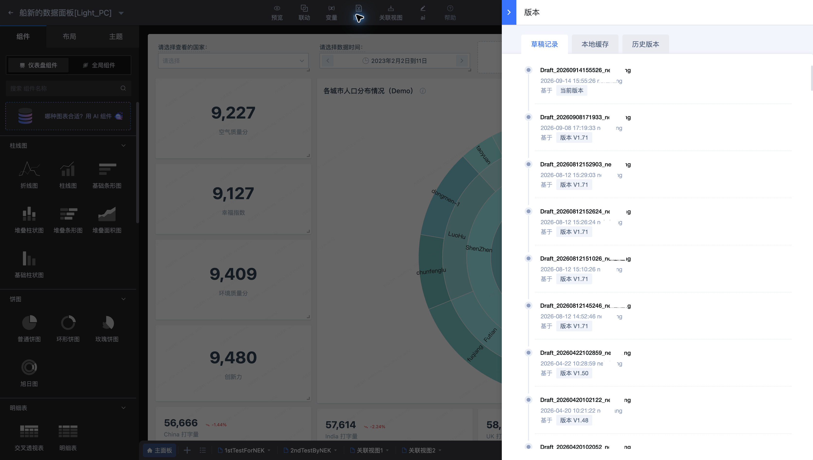
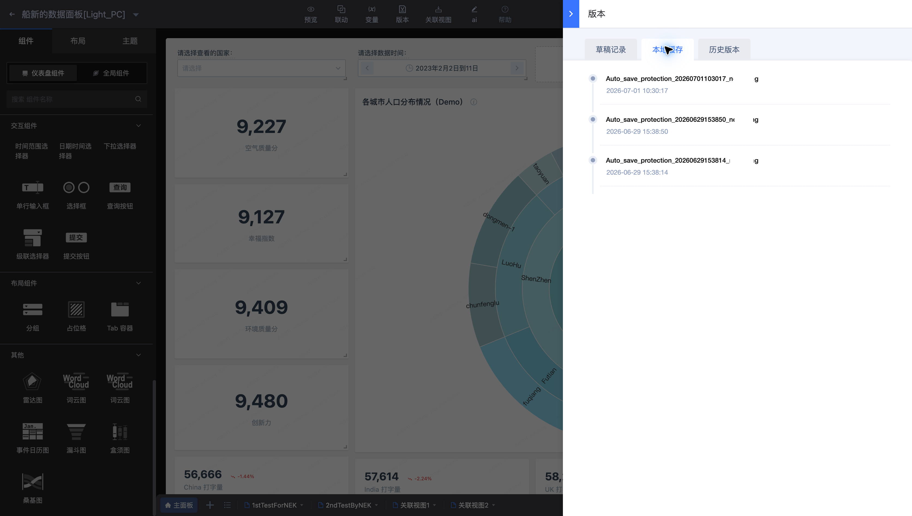
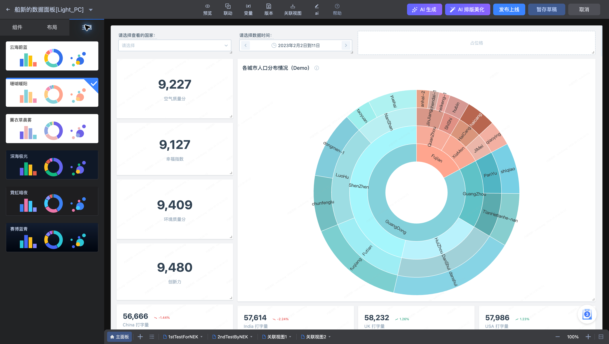

# 版本与主题

**船新的数据面板[Light_PC]** 的编辑工具栏提供版本管理，左侧面板提供主题选择。

## 管理版本

进入“版本”后，按版本名称、修改时间和修改人识别目标配置。恢复历史配置前，先预览并确认对应内容；恢复后仍需检查数据查询与交互。

草稿用于继续编辑，正式版本用于浏览。需要保留当前工作进度时使用“暂存草稿”；确认配置后再“发布上线”。

“本地缓存”提供当前浏览器保留的编辑记录。按时间核对记录，需要恢复时先预览；本地记录不能替代正式发布或业务备份。

## 设置主题

在“主题”面板选择主题并预览。当前面板包含云海蔚蓝、珊瑚暖阳、薰衣草晨雾、深海极光、霓虹暗夜、赛博蓝青等预设。

图表配色可选择跟随主题或自定义。切换主题后应检查背景与文字对比度、图例颜色，以及单独设置过颜色的组件。
