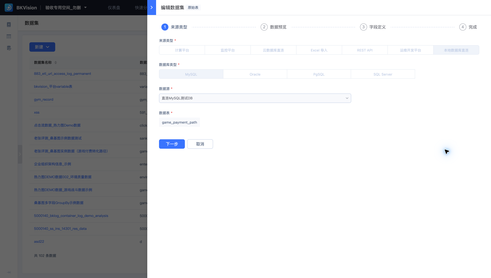
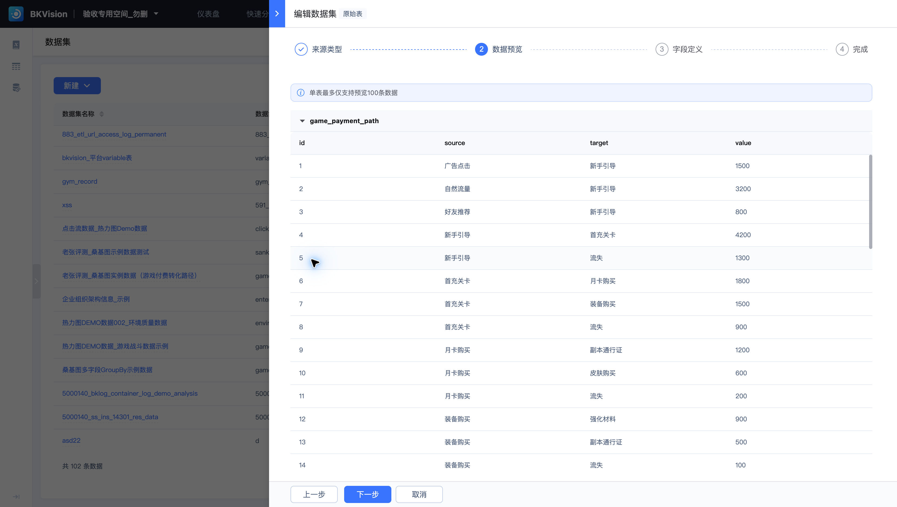
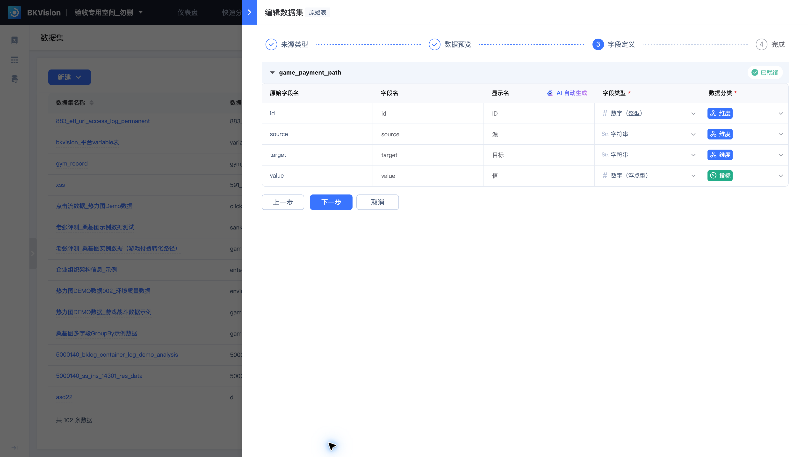
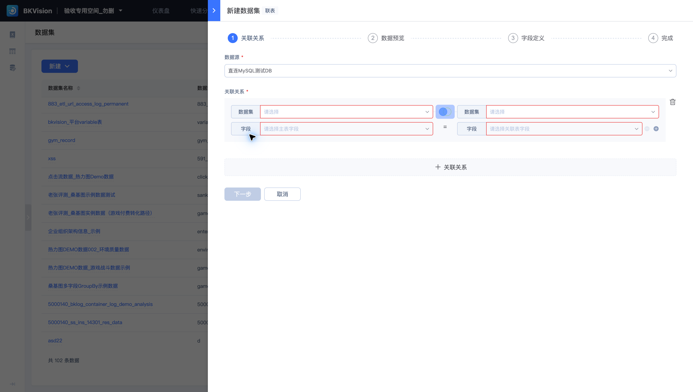
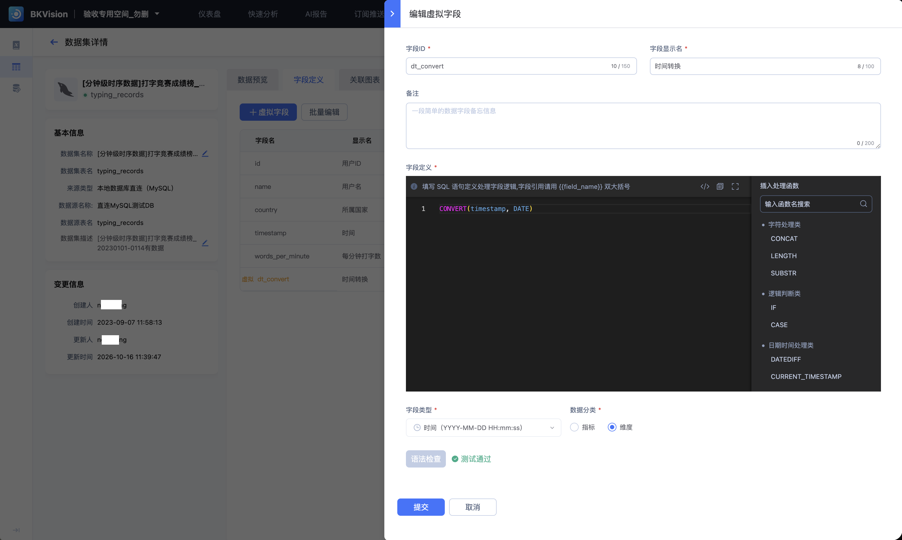

# 数据集

数据集将物理数据映射为可复用的逻辑表。本页以 **老张评测_桑基图实例数据（游戏付费转化路径）** 为例。

## 选择数据来源

在“数据管理 → 数据集”中选择“新建”，依次完成来源类型、数据预览、字段定义与完成步骤。已有资源可从列表进入“编辑”。

示例来源为本地数据库直连，数据库类型为 MySQL，数据源为 **直连MySQL测试DB**，物理表为 `game_payment_path`。编辑已有数据集时，来源信息呈只读状态。

## 预览数据

单表最多预览 100 条数据。样例记录包含来源节点 `source`、目标节点 `target` 和流量数值 `value`，如“广告点击 → 新手引导，1500”。预览用于检查字段和值，不代表完整数据量。

## 定义字段

| 字段 | 显示名 | 类型 | 数据分类 |
| --- | --- | --- | --- |
| id | ID | 数字（整型） | 维度 |
| source | 源 | 字符串 | 维度 |
| target | 目标 | 字符串 | 维度 |
| value | 值 | 数字（浮点型） | 指标 |

字段名用于查询，显示名用于阅读。数值字段也可能是维度，例如 ID；应按业务语义设置分类。完成定义后继续下一步并保存。

## 配置联表

在“新建”菜单选择“联表”，选择数据源后配置主表、关联表以及两侧关联字段。需要多组关系时使用“关联关系”入口继续添加，再预览结果并定义字段。

图中展示新建联表的配置入口，付费路径示例仍为单表。联表适用于同类型数据源；核对字段类型、连接条件与关联基数，避免重复行导致指标放大。

## 虚拟字段

在数据集中，可以通过使用原始数据库的函数创建 **虚拟字段** 对字段进行预处理，便于在图表中快捷使用

## 维护数据集

列表显示来源类型、状态、关联图表和更新信息。原始表结构变化后，应检查字段映射及引用图表。

删除前先检查“关联图表”，确认不再被使用。游戏路径分析的配置建议见[分析游戏付费转化路径](../../Best-Practices/Game-payment-conversion.md)。
