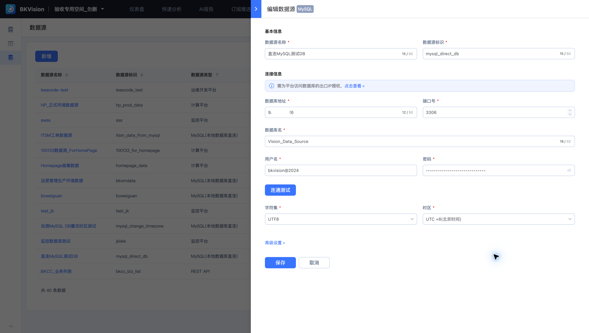

# 数据源

数据源保存数据库或接口的连接信息，供数据集与图表使用。本页以 **直连MySQL测试DB** 为例，其数据源标识为 `mysql_direct_db`。

## 配置 MySQL 连接

在“数据管理 → 数据源”中点击“新增”，选择数据源类型；已有连接可从列表进入“编辑”。

| 配置项 | 说明 |
| --- | --- |
| 数据源名称 | 便于业务用户识别的名称 |
| 数据源标识 | 数据源的唯一标识 |
| 数据库地址、端口 | 数据库连接入口；MySQL 常用端口为 3306 |
| 数据库名 | 需要查询的数据库 |
| 用户名、密码 | 用于访问数据库的账号信息 |
| 字符集、时区 | 与源数据编码和时间语义保持一致 |

按页面提示，为平台访问数据库的出口 IP 授权；“点击查看”可查看授权所需的出口信息。填写连接后使用“连通测试”，检查结果再保存。

## 使用与维护

保存数据源后，在[数据集](Data-set.md)中选择该连接和物理表。示例 `game_payment_path` 数据集使用此数据源。

列表展示数据源类型、关联数据集及更新信息。有数据集引用的数据源，其删除入口可能不可用。修改地址、账号或数据库前，应检查引用的数据集及图表是否仍可访问。

不同数据源类型的配置项不同，应按类型填写对应字段。不要把数据库的连接配置直接套用到 REST API 等连接。
