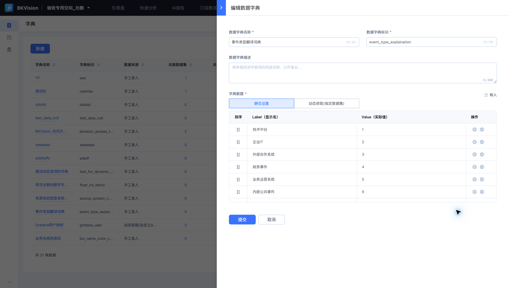
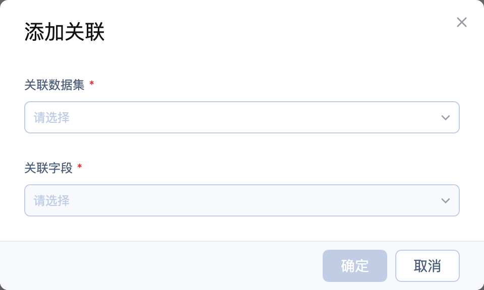
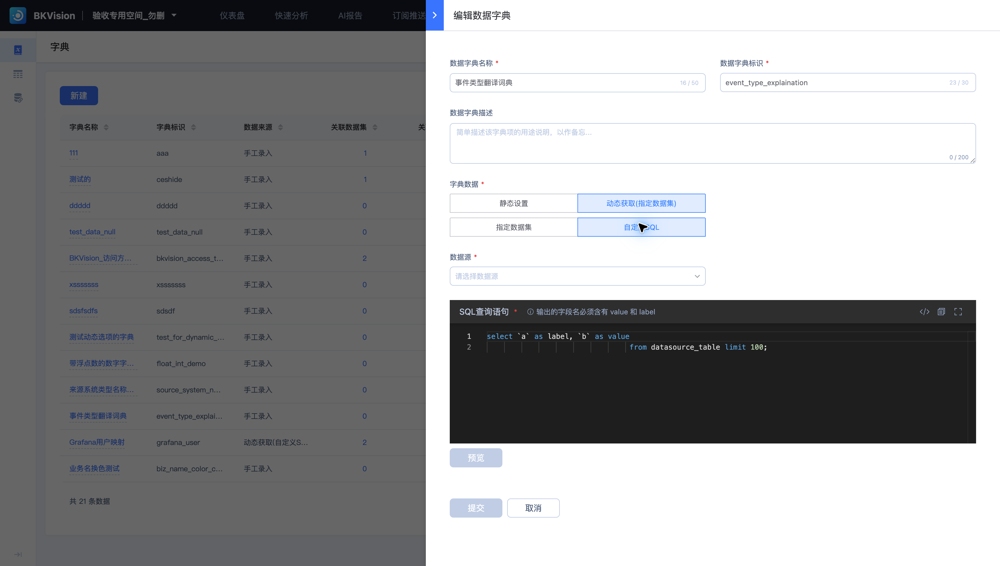

# 数据字典

字典将原始维度值映射为易读的显示名称。本页以 **事件类型翻译词典** 为例，标识为 `event_type_explaination`。

## 配置字典内容

1. 在“数据管理 → 字典”中新增字典，或编辑已有资源。
2. 设置名称、唯一标识和用途描述。
3. 选择“静态设置”或“动态获取(指定数据集)”。
4. 静态设置中逐项填写 Label 和 Value，检查映射后提交。

| 配置 | 含义 | 示例 |
| --- | --- | --- |
| Label（显示名） | 用户看到的文字 | 技术中台 |
| Value（实际值） | 与原始数据匹配的值 | 1 |
| 排序 | 字典项的排列顺序 | 拖动排序入口 |

示例还包括 `2 → 企业IT`、`3 → 外部合作系统` 等项。Value 应与维度原值一致；数字和字符串的差异需要在数据定义中核对。

## 关联使用

从列表的“添加关联”入口选择关联数据集和关联字段，确认后在图表中检查原值是否展示为正确的 Label。

## 动态获取字典

“动态获取(指定数据集)”提供指定数据集与自定义 SQL 两种取值入口。指定数据集时选择数据源与数据集，再按表单定义实际值与显示名。自定义 SQL 的输出字段必须含有 `value` 和 `label`，执行“预览”检查映射后提交。图中展示切换后的配置入口，既有事件类型词典使用静态设置。

切换取值模式会清空当前配置，应先核对提示并保留需要的数据。更新字典时检查引用范围；删除字典或移除字典项前，确认相关图表不再依赖该映射。
