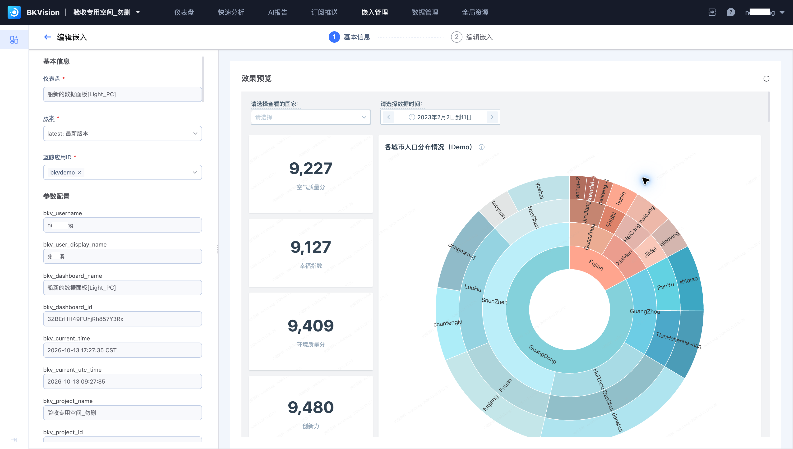
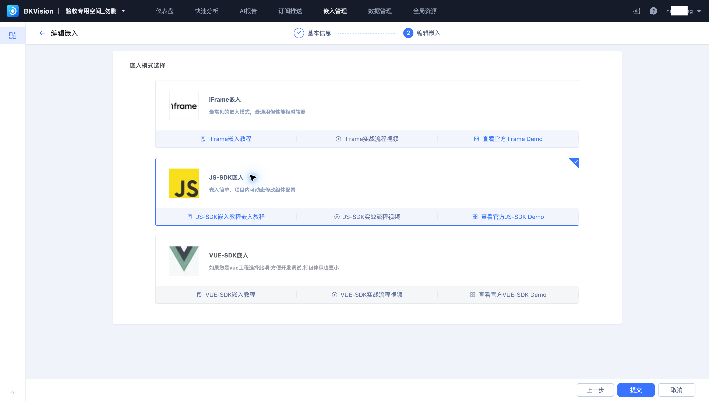
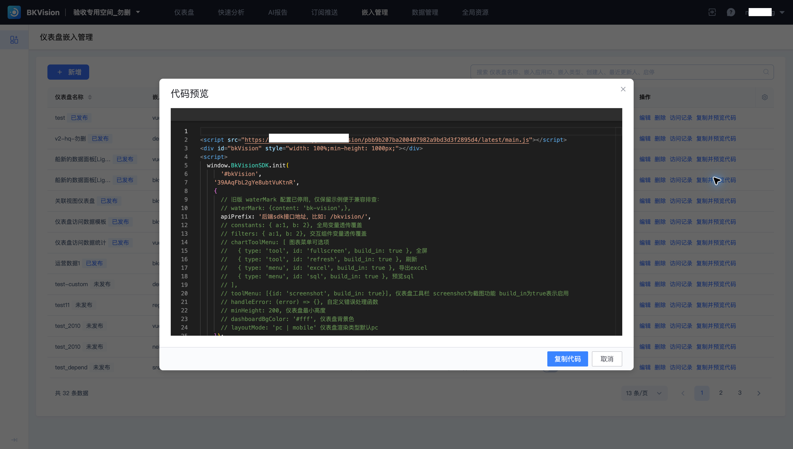
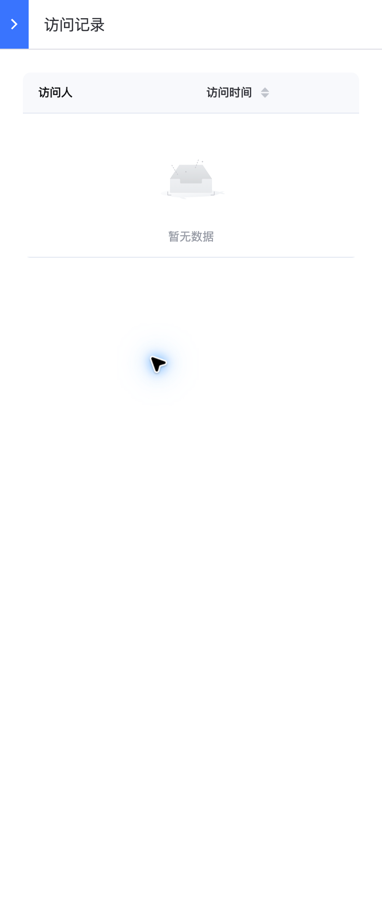

# 仪表盘嵌入管理

嵌入管理将仪表盘提供给指定蓝鲸应用。本页使用仪表盘 **船新的数据面板[Light_PC]**、应用 ID **bkvdemo**，嵌入类型为 **JS-SDK**。

## 配置基本信息

1. 进入“嵌入管理”，单击“新增”，或找到对应仪表盘与应用 ID 后单击“编辑”。
2. 选择仪表盘、版本和蓝鲸应用 ID。同名仪表盘可能有多个嵌入项，须同时核对应用 ID。
3. 检查水印选项和效果预览，然后单击“下一步”。

示例使用 `latest` 最新版本。选择固定版本适合需要控制展示变更的应用。

## 选择嵌入模式

| 模式 | 适用场景 |
| --- | --- |
| iFrame | 使用独立框架容器加载仪表盘 |
| JS-SDK | 在页面中初始化仪表盘，并传入配置 |
| VUE-SDK | 在 Vue 工程中集成仪表盘 |

按应用技术栈选择模式，参考页面对应教程。单击“提交”保存配置。

## 取得集成代码

在列表单击“复制并预览代码”。将生成代码交给应用开发者，按教程配置后端 SDK 接口地址 `apiPrefix`，并使用本嵌入项的标识初始化容器。

代码示例提供 `constants` 全局变量覆盖、`filters` 交互组件变量覆盖，以及图表菜单、仪表盘菜单和布局模式等选项。只配置业务需要的项，并核对变量名称与仪表盘定义一致。旧 `waterMark` 配置已停用，水印改由当前策略管理。

## 验证与维护

在目标应用验证加载、变量传值、布局和水印。在列表找到仪表盘与应用 ID 对应的嵌入项，单击“访问记录”，查看访问人和访问时间。

“暂无数据”表示当前列表没有可显示的访问记录。停用或删除嵌入项会影响对应集成，操作前核对仪表盘与应用 ID。删除入口位于列表操作列。
