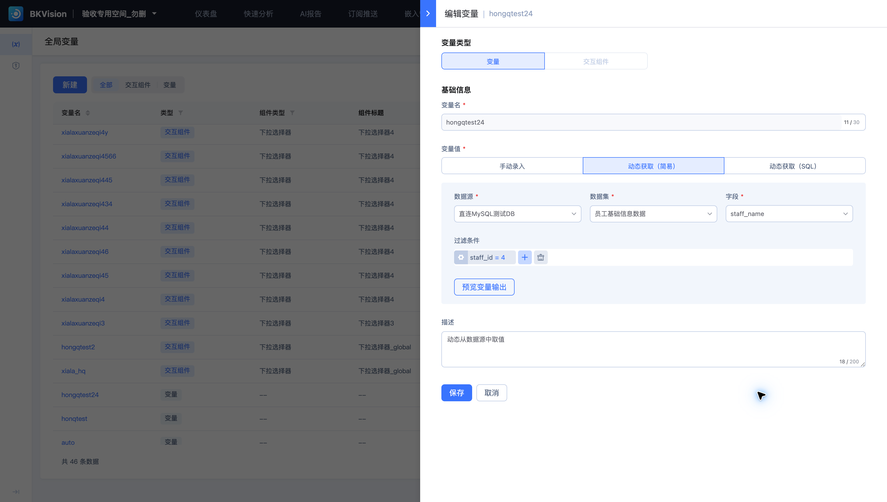

# 全局变量

全局变量在同一空间内统一定义，供多个仪表盘复用。本页以 **hongqtest24** 为例。

## 定义变量

1. 进入“全局资源 → 全局变量”，点击“新建”。
2. 选择类型“变量”，设置变量名和描述。
3. 选择手动录入、动态获取（简易）或动态获取（SQL）。
4. 动态获取时配置数据源、数据集、字段及过滤条件，使用“预览变量输出”核对结果。
5. 保存后在仪表盘的变量管理中引用。

变量名只允许小写字母、数字和下划线，并以字母或下划线开头。已有变量的名称在编辑时为只读。

## 动态取值示例

`hongqtest24` 从 **直连MySQL测试DB** 的“员工基础信息数据”中取 `staff_name`，条件为 `staff_id = 4`。该定义获取的是变量输出，不等同于在所有图表上直接添加相同过滤条件。

修改取值规则前，应查看关联仪表盘并核对输出形态。仪表盘中引用变量后，再检查默认查询和订阅运行时的参数。

参见[仪表盘变量](../Dashboard/Variables.md)和[交互组件](Interactive-components.md)。
