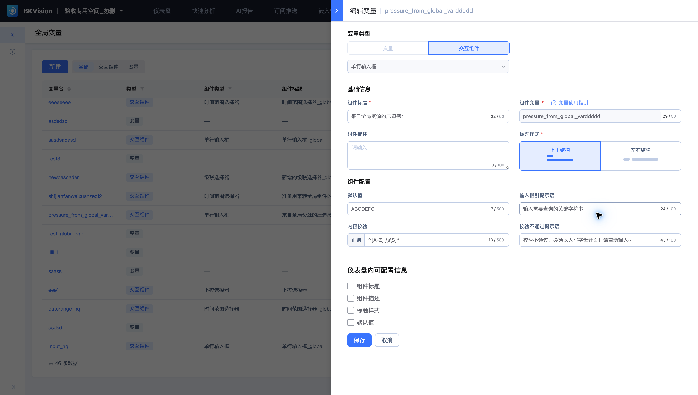

# 全局交互组件

全局交互组件统一管理输入与选择规则，在空间内的多个仪表盘中复用。本页使用 **pressure_from_global_varddddd**，组件类型为单行输入框。



## 配置输入规则

1. 在“全局资源 → 全局变量”中选择类型“交互组件”。
2. 设置组件标题、组件变量、描述与标题布局。
3. 配置默认值、输入指引和内容校验。
4. 设置哪些信息允许在仪表盘内单独配置，保存定义。
5. 在仪表盘编辑页的“全局组件”中引用，并核对输入行为。

示例标题为“来自全局资源的压迫感：”，默认值为 `ABCDEFG`。内容校验正则为：

```regex
^[A-Z][\s\S]*
```

该规则要求输入以大写字母开头；校验失败时显示已配置的提示语。默认值也应满足校验规则。

## 控制复用范围

“仪表盘内可配置信息”包括组件标题、组件描述、标题样式和默认值。勾选需要允许局部配置的项目，使统一定义与具体页面需求相匹配。

全局定义变化会涉及引用它的仪表盘。修改后检查关联仪表盘中的标题、默认值和查询结果；删除前确认没有必要的引用。
