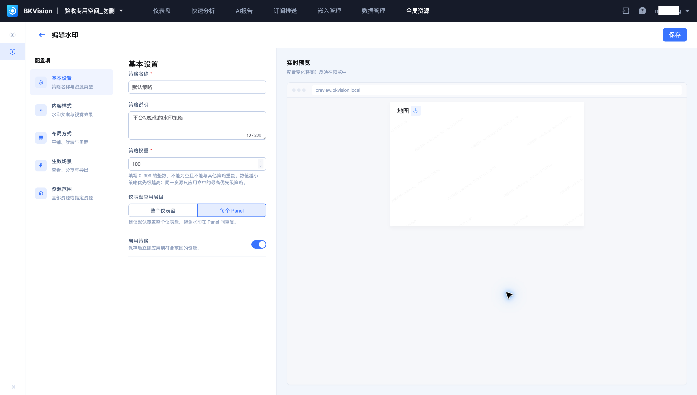
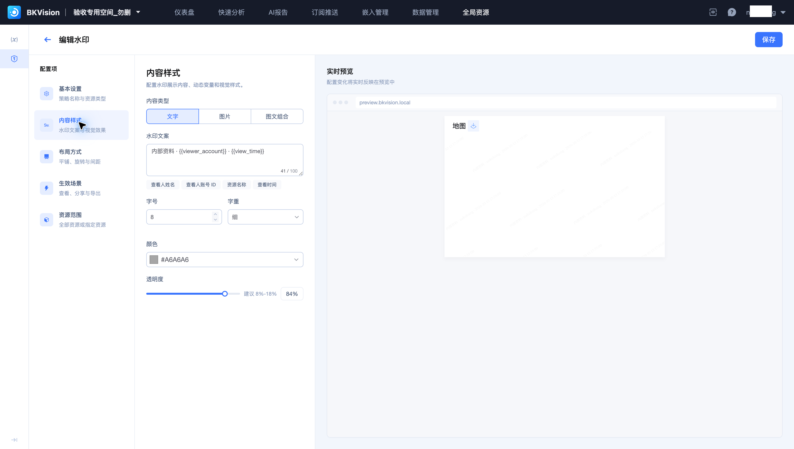
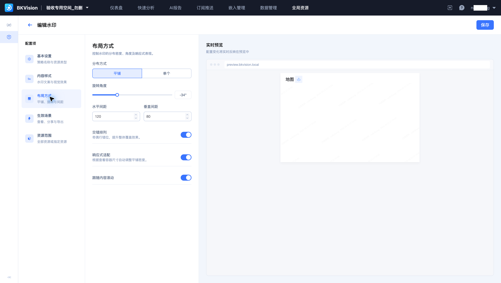
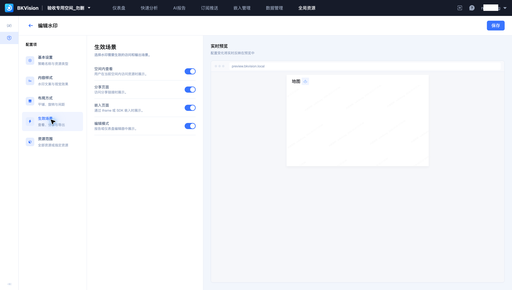
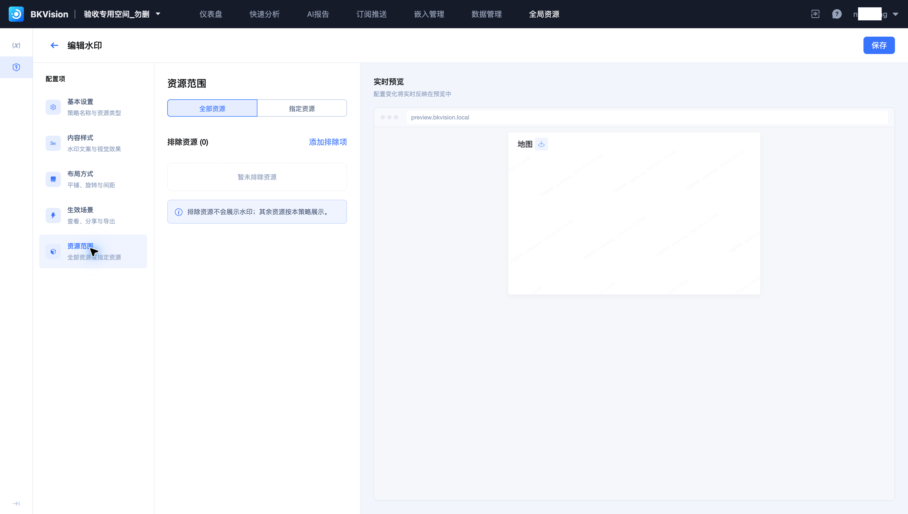

# 水印管理

水印策略管理仪表盘的水印内容、布局、场景与资源范围。本页以平台初始化的 **默认策略**（权重 100）为例。

## 基本设置与优先级

在“全局资源 → 水印管理”中新建或编辑策略。填写名称、说明和权重，选择覆盖整个仪表盘或每个 Panel，并设置启用状态。

权重必须是 0–999 的整数，不能与其他策略重复。数值越小优先级越高；同一资源命中多个策略时，只应用最高优先级策略。保存启用的策略后，会应用到符合范围的资源。

## 内容与布局

可选择文字、图片或图文组合。文字支持查看人姓名、查看人账号 ID、资源名称、查看时间等动态变量。默认文案使用查看人账号和查看时间，样式可设置字号、字重、颜色与透明度。

布局支持平铺或单个水印，并配置旋转角度、水平与垂直间距、交错排列、响应式适配及跟随内容滚动。使用实时预览检查密度和可读性。

## 生效场景与资源范围

按实际使用入口选择生效场景。应分别检查平台查看、分享、嵌入与导出的效果。

设置全部资源或指定资源；需要例外时配置排除范围。保存前核对范围和优先级，避免已有策略被覆盖。水印用于标识展示来源，访问权限仍需按资源和集成方式配置。
