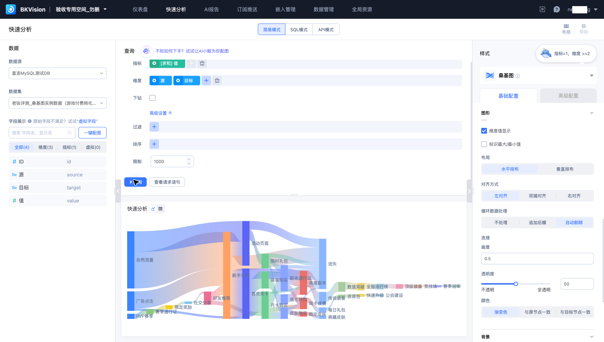
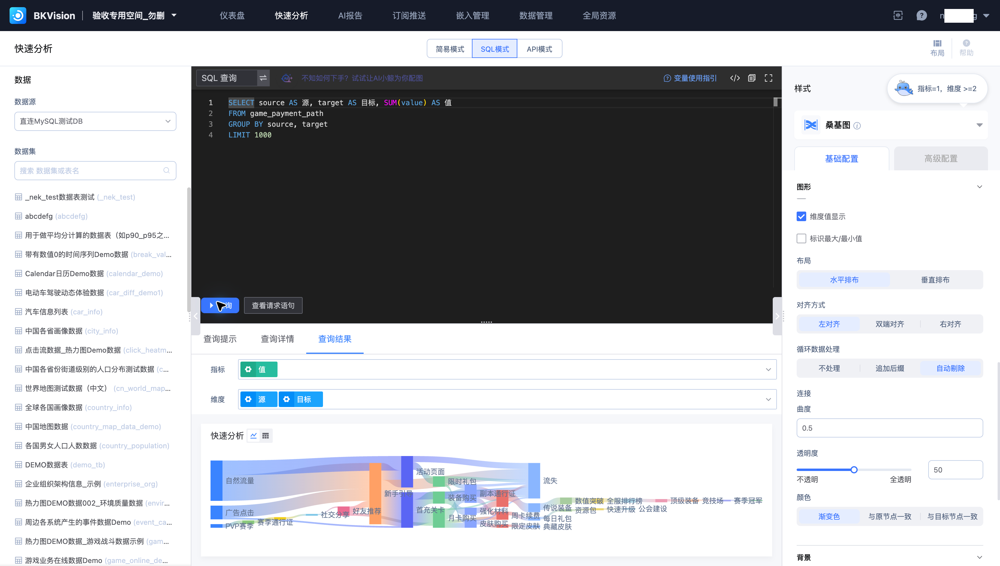
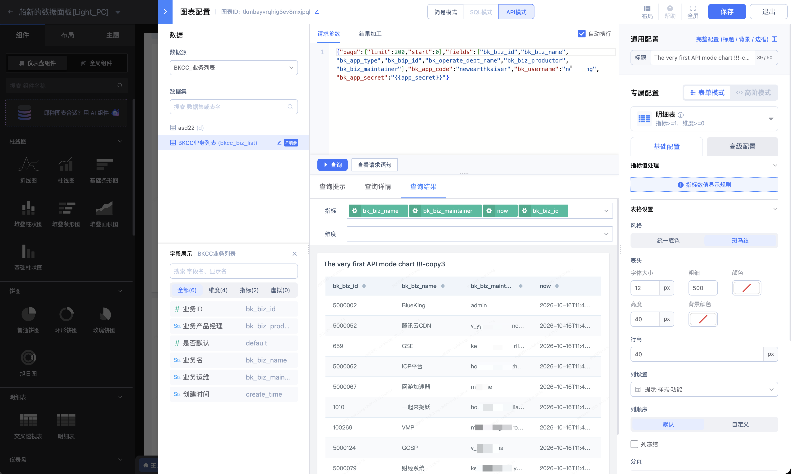

# 快速分析

快速分析适合临时验证数据问题，在同一页面选择数据、配置查询和查看图表。本页以 **老张评测_桑基图实例数据（游戏付费转化路径）** 说明数据分析。

## 使用简易模式

1. 在顶部选择“简易模式”，选择数据源与数据集。
2. 选择图表类型，按要求添加指标与维度。桑基图使用 `value` 指标和 `source`、`target` 维度。
3. 设置聚合、过滤、排序和限制，单击“查询”。
4. 核对图表数值，再通过右侧样式设置标题、提示窗、配色及布局。

## 使用 SQL 模式

选择对应数据源，输入查询语句并运行。查询完成后，将结果字段映射为指标和维度。示例按 `source`、`target` 聚合 `SUM(value)`。

“查询提示”用于查看查询建议，“查询详情”用于检查执行信息，“查询结果”用于检查结果与展示。需要定位查询条件时，可打开“查看请求语句”。长时间运行的查询可使用“中止”。

## 使用 API 模式

API 模式提供“请求参数”和“结果加工”配置区域。选择已接入的接口数据集，按接口定义设置参数，再查询并检查返回结构。参数涉及的变量、分页和结果加工应与数据源定义一致。

该入口图展示尚未选择接口数据集的状态；付费路径示例为 MySQL 数据，应使用简易或 SQL 模式。

## 检查展示结果

查询成功后仍需满足组件的字段要求。桑基图遇到循环数据时，应检查“循环数据处理”，并确认追加后缀或剔除路径对业务含义的影响。需要长期复用的查询，可按[图表配置](../Dashboard/Chart-Configuration.md)保存到仪表盘。
