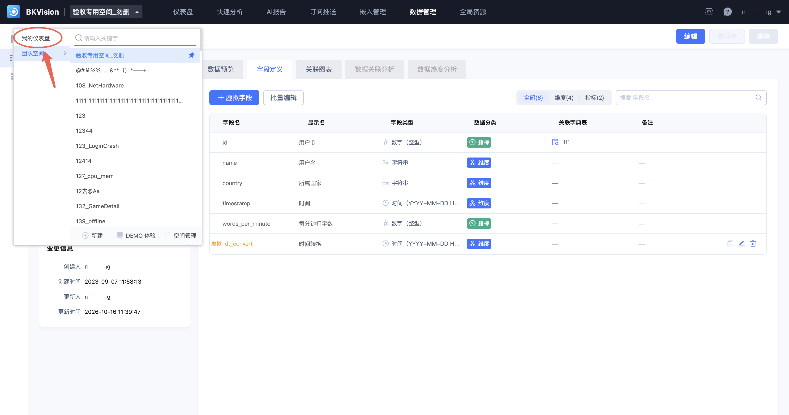
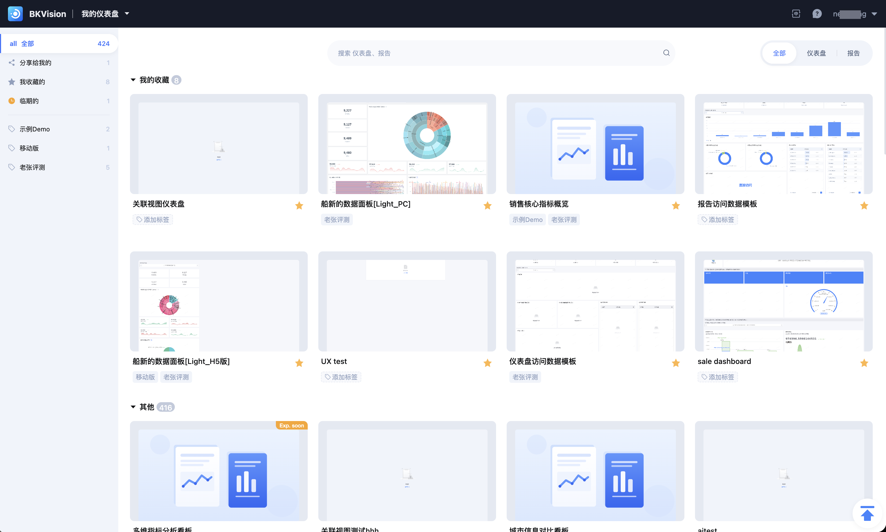
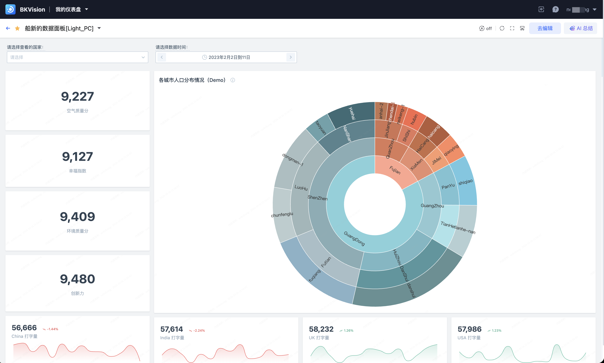

# 个人空间

**个人空间** 是面向图表平台的“被分享方”的、以用户维度的私有空间，主要用途是集中展示和管理自己收藏或别人分享的仪表盘或者分析报告；通过个人空间，用户可以不需要单独收藏别人分享的图表链接，在一个地方管理所有的仪表盘和报告。

## 进入空间

单击顶部空间切换器，通过“我的仪表盘”进入个人空间。

## 查看和管理

在个人空间中，可以通过左侧的菜单快速切换 别人“分享给我的”、“我收藏的”和“临期的”视图；并可以通过标签快速筛选查看个性化定义的属性视图。

只要有仪表盘或报告的查看权限，即可在个人空间直接查看，和 **团队空间** 的权限是隔离的；这样就不用让纯查看仪表盘的用户进入到团队管理空间，避免了权限或信息泄露的问题。

想要进入团队管理空间的仪表盘，详见[仪表盘](../Dashboard/Dashboard.md)。
