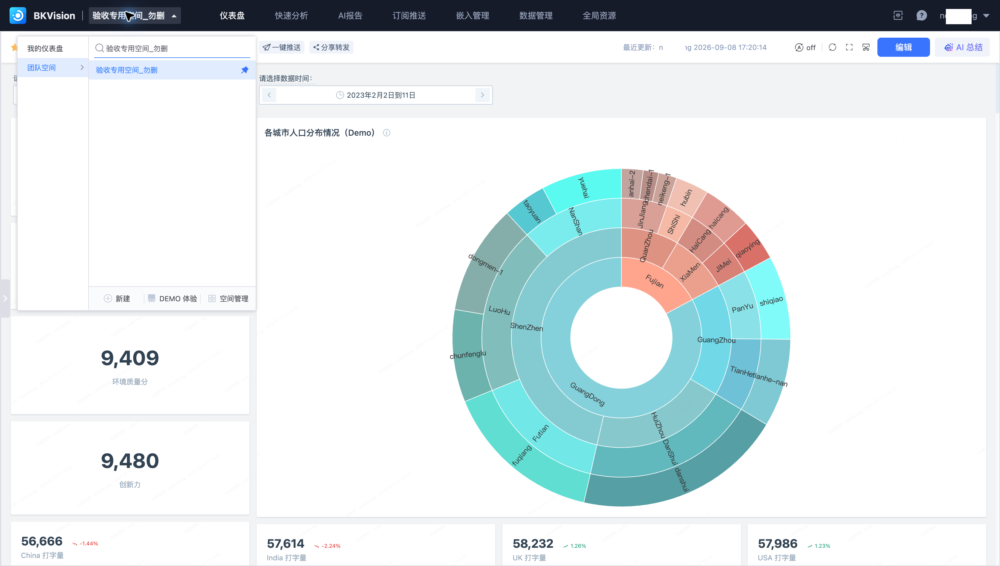
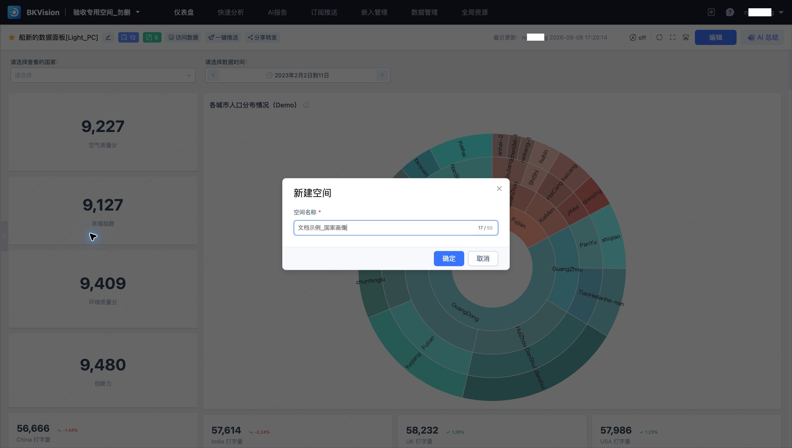
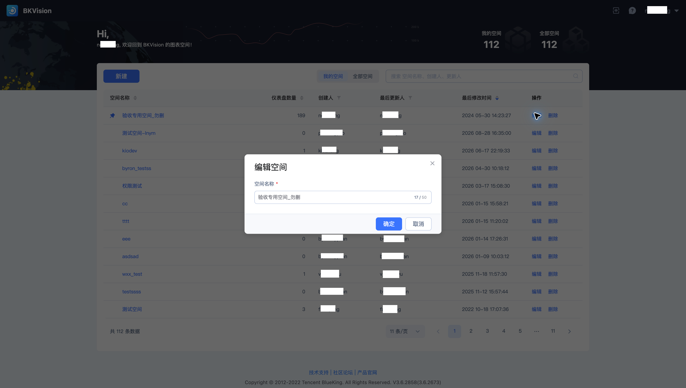

# 团队空间

**团队空间** 用于组织一组业务资源。仪表盘、数据管理、订阅、嵌入及全局资源都应在正确空间内操作。本页使用 **验收专用空间_勿删**。

## 切换与定位

单击顶部空间名称，搜索并选择目标空间。进入后核对名称，再查找仪表盘或数据资源。空间菜单同时提供“我的仪表盘”“团队空间”“新建”和“空间管理”等入口。

资源不可见时，先检查当前空间及访问权限，再检查搜索条件和分类；不要为找不到的已有资源重复创建同名对象。

## 创建与维护

在空间菜单选择“新建”，填写名称与页面要求的信息。使用统一业务命名，避免多个空间职责重叠。

“空间管理”按“我的空间”和“全部空间”查看列表，显示仪表盘数量、创建人、更新人和更新时间。单击“编辑”维护空间名称。数据源和全局资源在空间内复用，修改前应检查引用关系。删除入口位于操作列，执行前核对空间及其资源影响。

仪表盘通过目录组织，详见[仪表盘](../Dashboard/Dashboard.md)。
