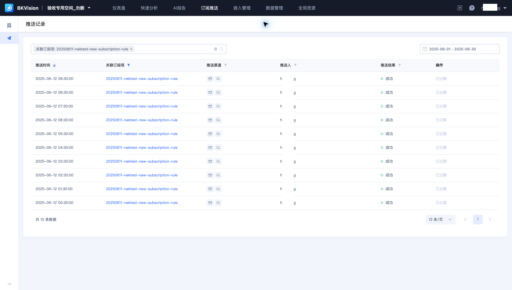

# 推送记录

推送记录显示每次任务的执行时间、渠道、推送人和结果。本页沿用订阅 **20250611-nektest-new-subscription-rule**。

## 查询记录

1. 在“订阅配置”列表找到订阅，单击“推送记录”，直接按该订阅筛选。
2. 选择日期范围。查看较早的任务时，选择包含实际推送日期的起止时间。
3. 核对推送时间、渠道与结果。单击关联订阅名称可查看对应配置。

示例选择 2025-06-01 至 2025-06-30，显示 10 条成功记录。初始“最近一个月”范围不包含这些历史任务。

## 判断结果

“成功”表示该次任务执行成功，不能仅凭此判断接收人是否已阅读。失败时，检查记录提供的详情以及订阅的仪表盘版本、参数、渠道和接收人配置。

操作列显示“已过期”时，该记录的内容查看入口已不可用；推送时间与状态仍可用于追溯。需要长期保存的输出，应在有效期内按业务要求归档。

相关操作见[订阅配置](Subscription-configuration.md)。
