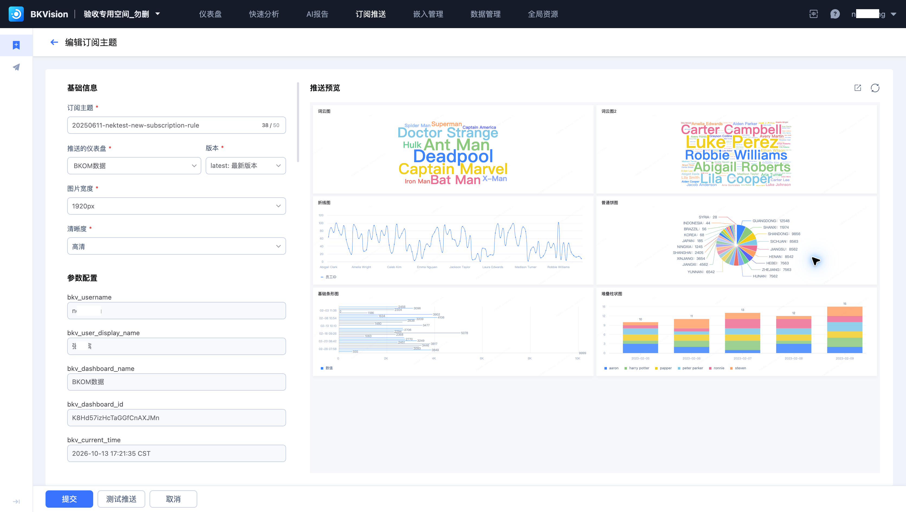
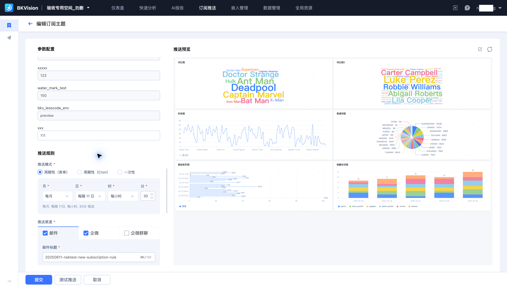
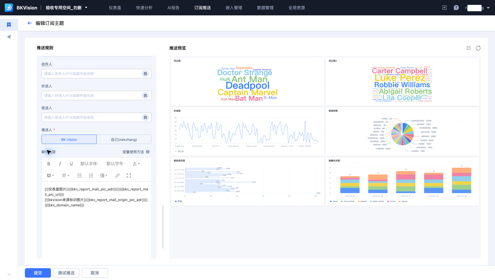

# 订阅配置

订阅任务按指定时间生成仪表盘图片，并通过邮件或企微等渠道发送。本页使用 **20250611-nektest-new-subscription-rule**；该订阅的目标仪表盘为“BKOM数据”。

## 选择仪表盘与参数

1. 进入“订阅推送 → 订阅配置”，新建订阅主题或编辑已有订阅。
2. 设置主题名称、推送的仪表盘、版本、图片宽度和清晰度。
3. 配置仪表盘变量。只读参数由平台或变量定义提供；可编辑参数用于指定本次推送的查询条件。
4. 在右侧预览中核对数据和布局。

`latest` 表示使用最新版本。选择固定版本时，应确认该版本仍符合业务需求。浏览页面手动选择的筛选条件不会自动替代订阅配置中的参数。

## 设置推送规则

| 模式 | 用途 |
| --- | --- |
| 周期性（表单） | 通过月、日、时、分设置重复推送 |
| 周期性（Cron） | 使用 Cron 配置周期规则 |
| 一次性 | 在指定时间推送一次 |

设置后，核对页面汇总的时间规则。示例订阅使用表单周期，页面显示“每月，每隔 11 日，每小时，30 分”。

## 设置渠道与接收人

页面提供邮件、企微和企微群聊渠道。邮件可配置标题、收件人、抄送人、密送人、推送人、邮件内容及 PDF 附件。企微渠道按对应字段配置接收人或群聊会话。

“测试推送”会实际发送测试通知，执行前核对接收范围。“提交”保存订阅配置；需要停止周期任务时，在列表检查对应任务的状态操作。历史结果见[推送记录](Push-record.md)。
