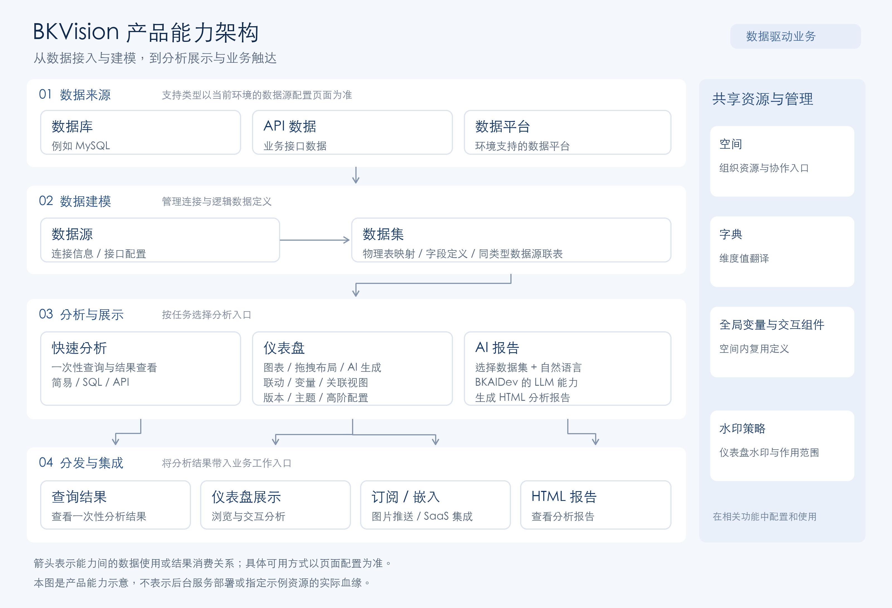
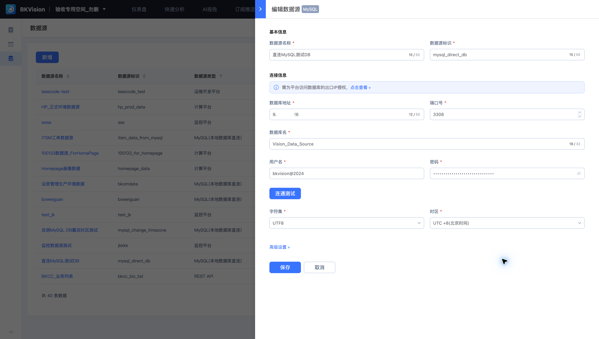
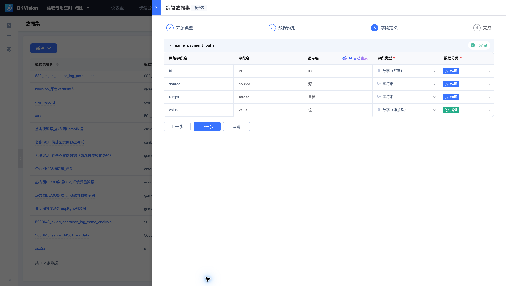
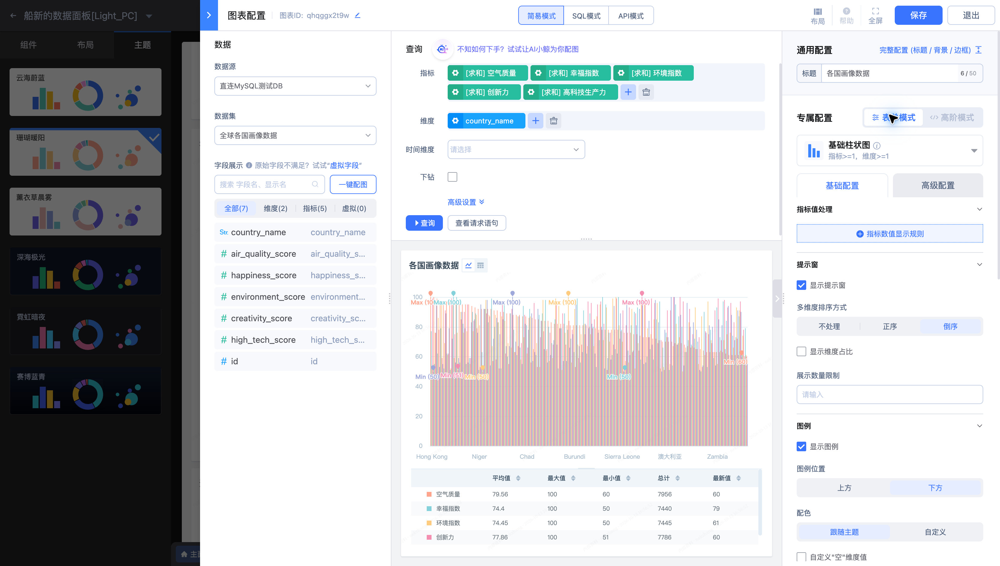

# 产品架构

BKVision 以空间组织资源，将数据连接、逻辑建模、可视化分析与业务触达串联起来。

[下载 SVG 架构图](../Media/Introduction/BKVision-product-architecture.svg)。

## 数据接入与建模

数据源保存连接信息；数据集映射物理表并管理字段，也可定义同类型数据源的联表关系。字典为维度值提供显示翻译。

## 分析与展示

快速分析适合一次性验证数据；仪表盘适合持续观察和交互分析；AI 报告通过所选数据集与自然语言需求生成 HTML 报告，使用 BKAIDev 提供的 LLM 能力。

## 结果消费

用户可直接浏览仪表盘，通过订阅接收图片，或在蓝鲸 SaaS 中嵌入仪表盘。空间内的全局变量与交互组件可复用，水印策略管理仪表盘的展示水印。

本图描述产品能力及其使用关系，具体连接类型与配置方式请参见各功能页。
