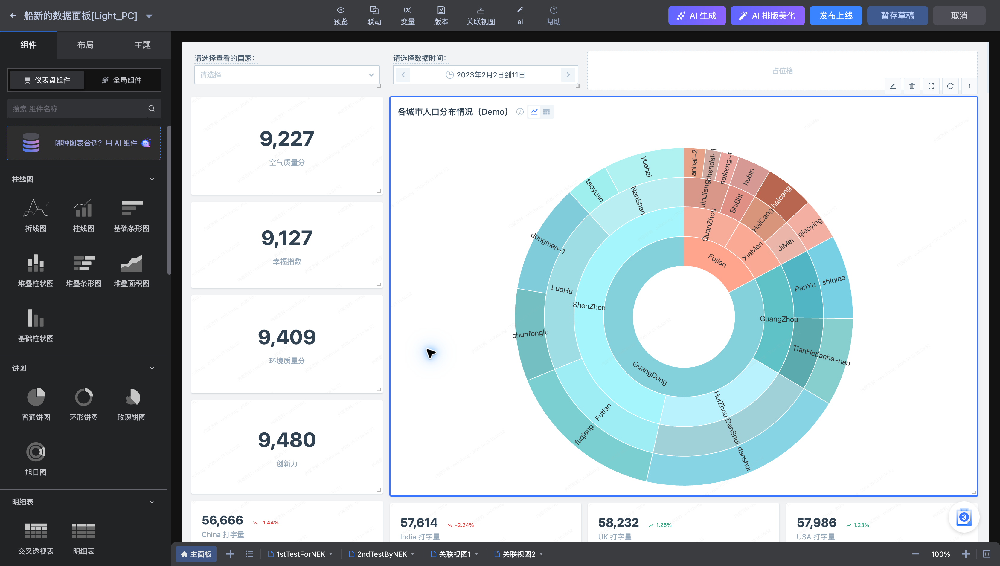
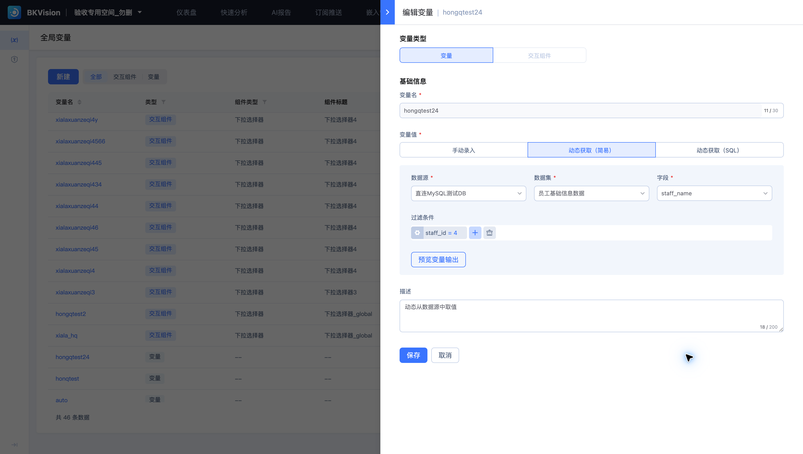
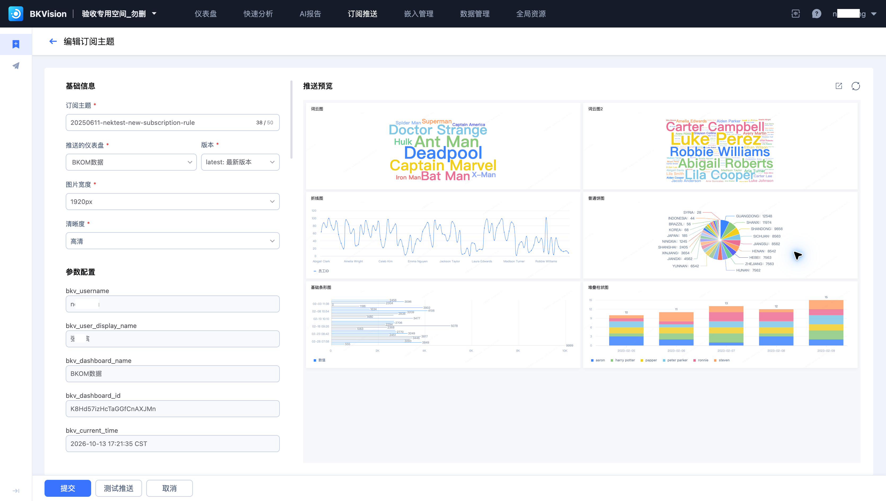

# 特点及优势

BKVision 将数据查询、图表配置和业务展示集中在同一工作空间，减少重复建模与页面开发。

| 特点 | 如何使用 | 带来的价值 |
| --- | --- | --- |
| 多种查询方式 | 按任务选择简易、SQL 或 API 模式 | 兼顾业务配置与技术分析 |
| 自由排布组件 | 拖动、调整大小，组合图表和筛选器 | 适应不同业务看板的展示需求 |
| AI 辅助构建 | 选择数据集并描述需求，生成图表或报告 | 缩短从分析问题到可视化结果的过程 |
| 交互分析 | 联动、变量与关联视图 | 从总览逐步定位到明细 |
| 资源复用 | 数据集、字典、全局变量和交互组件统一管理 | 减少重复配置，方便统一维护 |
| 业务触达 | 图片订阅与 SaaS 嵌入 | 将数据带到业务工作入口 |
| 发布管理 | 草稿、版本与主题 | 支持持续调整和一致展示 |

根据业务频率选择入口：临时问题从快速分析开始；固定指标沉淀为仪表盘；需要文字结论时使用 AI 报告，并核对数据口径和结论。
