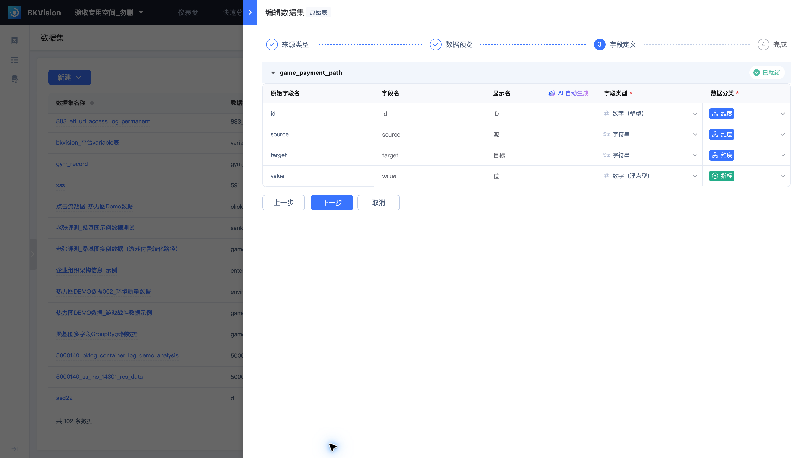
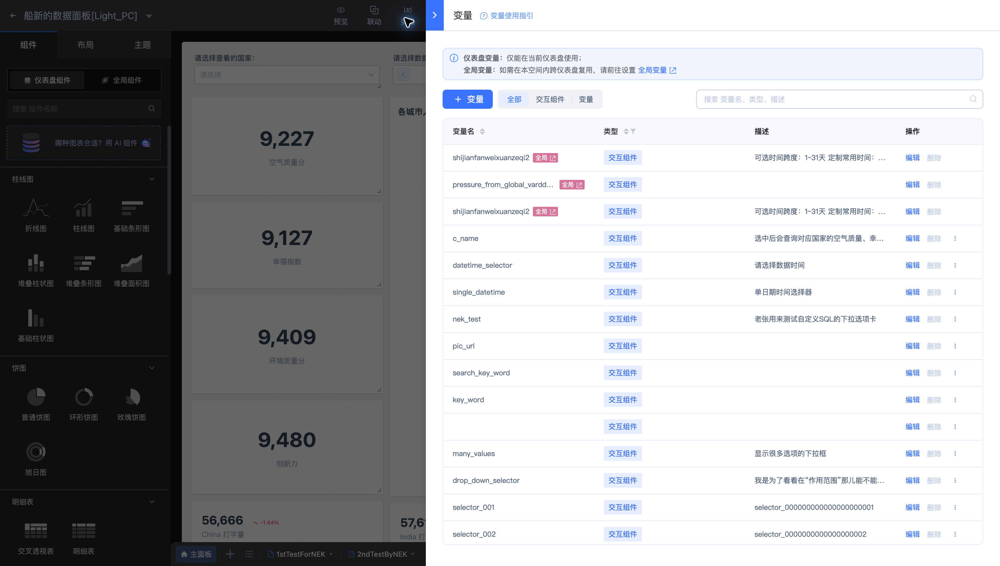

# 术语解释

| 术语 | 含义 | 示例或用途 |
| --- | --- | --- |
| 空间 | 组织平台资源的工作范围 | 验收专用空间_勿删 |
| 数据源 | 保存数据库或业务接口的连接信息 | 直连MySQL测试DB |
| 数据集 | 在连接基础上定义的逻辑数据表，维护字段信息供查询复用 | 老张评测_桑基图实例数据（游戏付费转化路径） |
| 维度 | 对数据分组或描述的字段 | 国家、事件类型、日期 |
| 指标 | 用于衡量业务的数值字段或聚合结果 | 数量、金额、平均分 |
| 图表 | 将查询结果映射到可视化组件 | 柱状图、明细表、桑基图 |
| 仪表盘 | 组织多个图表与交互组件的画布 | 船新的数据面板[Light_PC] |
| 联动 | 将主图中选择的维度值传给其他图表 | 按性别筛选员工明细 |
| 关联视图 | 从图表打开另一个视图面板 | 弹窗、侧边或下方抽屉 |
| 变量 | 可供查询或展示引用的参数 | 国家选择、时间范围 |
| 全局变量 | 在同一空间的多个仪表盘中复用的变量定义 | hongqtest24 |
| 字典 | 将维度原始值映射为便于阅读的显示值 | 事件类型翻译词典 |
| 草稿 | 编辑过程中的工作版本 | 暂存后可继续编辑 |
| 正式版本 | 发布上线供浏览的仪表盘版本 | 浏览入口所展示的配置 |
| AI 报告 | 基于所选数据集和自然语言需求生成的 HTML 分析报告 | 全球实时数据指挥中心 · NEXUS GRID |
| 订阅 | 按一次性或周期规则生成并发送仪表盘图片的任务 | 20250611-nektest-new-subscription-rule |
| 嵌入项 | 针对指定应用设置的仪表盘集成配置 | 应用 ID：bkvdemo |
| 目录 | 组织仪表盘的分类层级 | 业务目录与子目录 |
| 时间维度 | 用于按时间分组的字段 | 日、小时等统计粒度 |
| 聚合 | 对分组中的数值执行计算 | 求和、平均值 |
| 下钻 | 从当前维度逐级查看更细的分类 | 从总览进入下一层维度 |
| 主题 | 画布与图表的视觉样式预设 | 图表配色可跟随主题 |
| 交互组件 | 让用户输入或选择参数的组件 | 国家下拉选择器、查询按钮 |
| 水印策略 | 管理仪表盘水印内容与适用范围的规则 | 默认策略 |

数据源负责连接，数据集负责逻辑定义，图表负责查询与呈现。三者可以复用；修改连接或字段时，应同时检查引用它们的图表。
