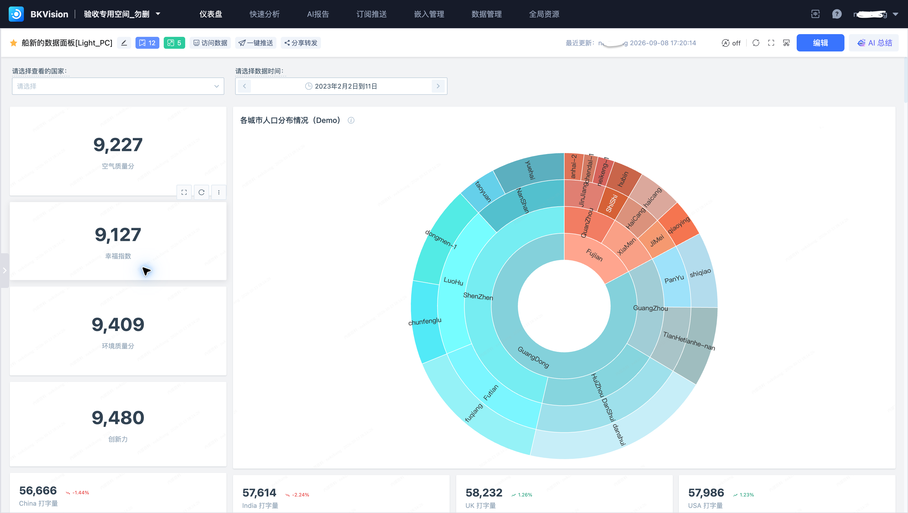
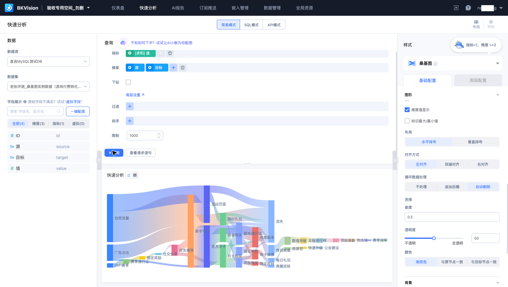
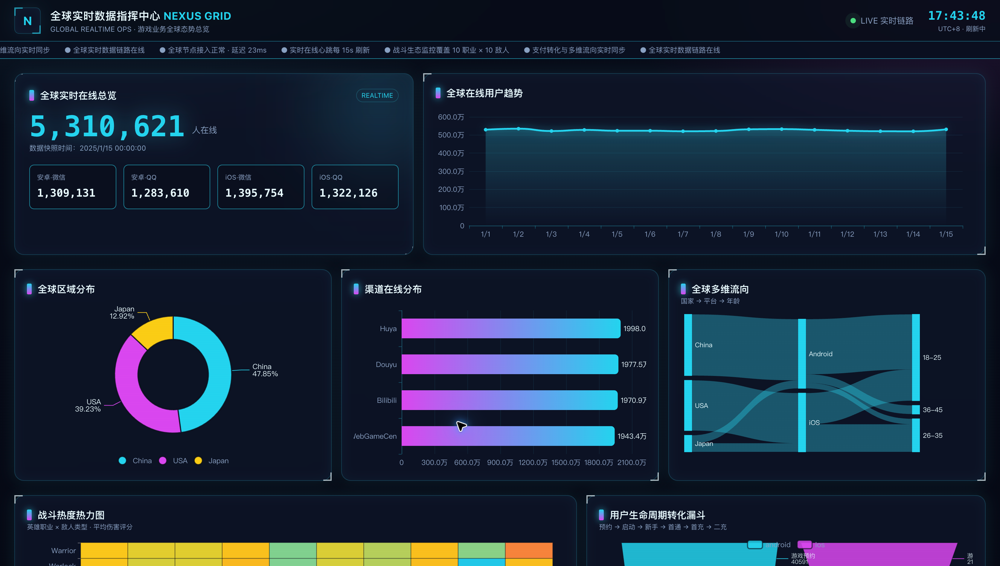

# 什么是 BKVision

蓝鲸图表平台（BKVision）是一款数据可视化工具。连接业务数据后，您可以通过表单、SQL 或 API 配置图表，在画布上自由排布组件，或使用 AI 辅助生成仪表盘与分析报告。

## 可以完成哪些工作

| 需求 | 功能入口 | 输出 |
| --- | --- | --- |
| 快速验证一个数据问题 | 快速分析 | 查询结果与图表 |
| 持续跟踪业务指标 | 仪表盘 | 可交互的业务看板 |
| 通过自然语言分析数据 | AI 报告 | HTML 分析报告 |
| 定时发送业务看板 | 订阅推送 | 仪表盘图片 |
| 将看板集成到业务系统 | 嵌入管理 | 面向指定 SaaS 的嵌入配置 |
| 统一管理可复用对象 | 数据管理、全局资源 | 数据集、字典、变量、组件与水印策略 |

## 开始使用

先选择空间，再按“数据源 → 数据集 → 图表 → 仪表盘 → 分发”的顺序完成接入。已有连接和数据集可直接复用。

- [快速入门](../Quick-Starts/1.Create-Space.md)
- [产品架构](Architecture.md)
- [术语解释](Terms.md)
