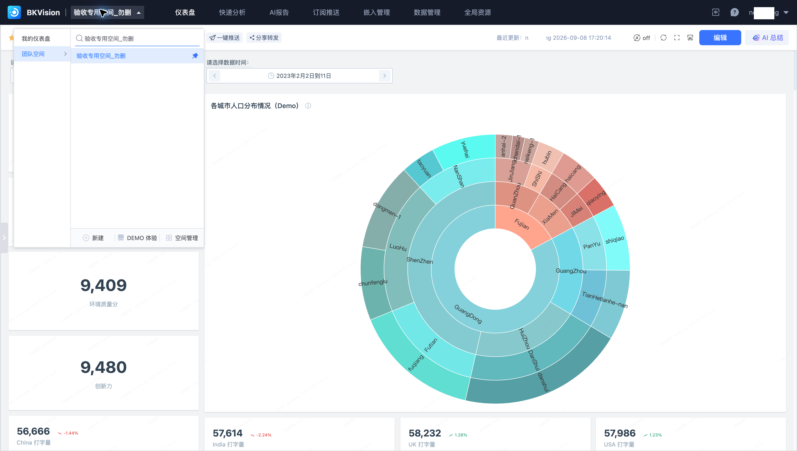
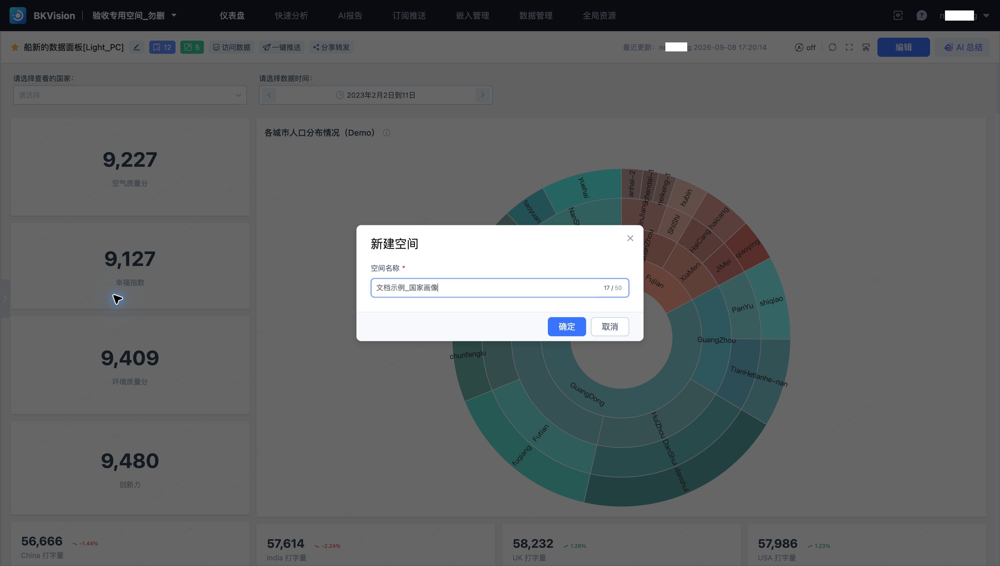

# 1. 选择或创建空间

空间组织仪表盘、数据与共享资源。本教程使用 **验收专用空间_勿删**，完成国家画像指标对比；已有空间与资源时直接复用。

## 进入已有空间

1. 单击顶部当前空间名称，打开空间选择菜单。
2. 搜索“验收专用空间_勿删”，选择该空间。
3. 核对顶部空间名称，再进入所需功能。

## 创建新空间

需要独立组织资源时，在空间菜单单击“新建”，填写空间名称及页面要求的信息，然后提交。名称应表达业务范围。创建后核对当前空间，再接入数据。

本教程后续连续使用“直连MySQL测试DB → 全球各国画像数据 → 船新的数据面板[Light_PC] → 各国画像数据图表”，已有资源无需重复创建。

下一步：[2. 接入数据源](2.Create-data-source.md)。
