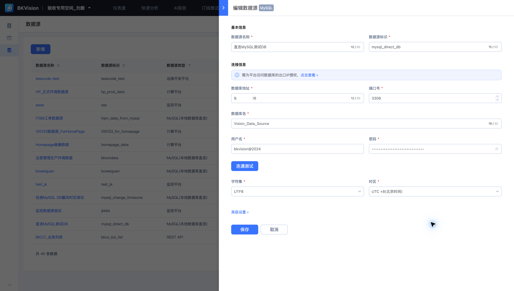

# 2. 接入数据源

本教程连续使用 **验收专用空间_勿删 → 直连MySQL测试DB → 全球各国画像数据 → 船新的数据面板[Light_PC] → 各国画像数据图表**，完成国家画像指标对比。已有这些资源时，可直接复用。

## 配置连接

1. 进入“数据管理 → 数据源”。新建资源时选择 MySQL；复用时找到“直连MySQL测试DB”。
2. 填写数据源名称、唯一 ID、连接地址、端口、库名和认证信息。
3. 检查字符集、时区和数据库访问规则，按页面提供的出口 IP 配置允许访问。
4. 执行连通测试，通过后保存。

教程中的连接已存在，无需重复创建。连接配置用于访问数据，业务字段在下一步的数据集中定义。

下一步：[3. 创建数据集](3.Create-data-set.md)。
