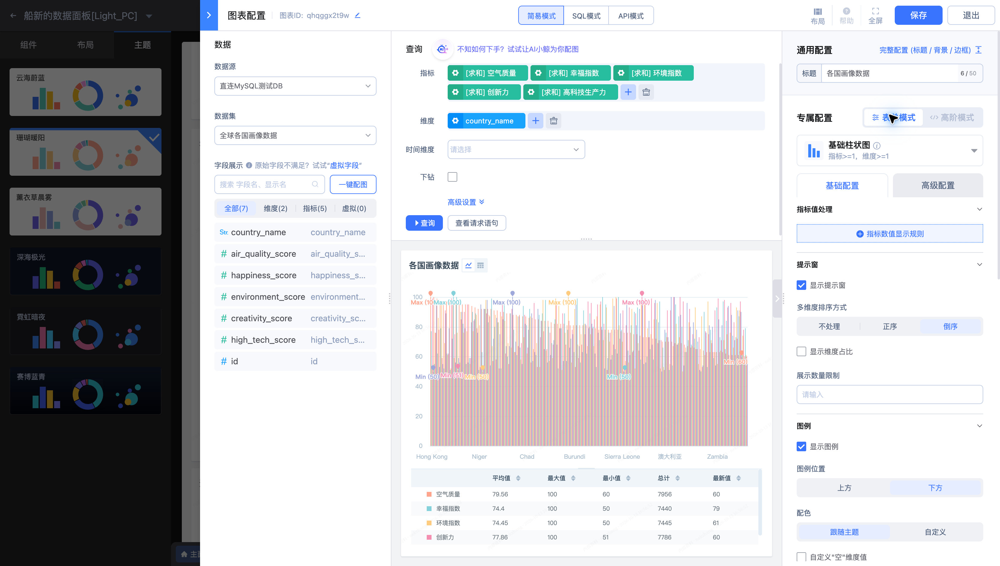

# 3. 创建数据集

继续使用 **直连MySQL测试DB**。国家画像数据集 **全球各国画像数据** 映射物理表 `country_info`，供“船新的数据面板[Light_PC]”内的“各国画像数据”图表使用。

## 定义可复用字段

1. 在“数据管理 → 数据集”选择“新建”，选择数据源“直连MySQL测试DB”。已有“全球各国画像数据”时直接复用。
2. 选择物理表 `country_info`，预览数据。
3. 将 `country_name` 定义为国家维度；将以下数值字段定义为指标。
4. 保存后，在图表配置中确认数据集和字段可选。

| 字段 | 用途 |
| --- | --- |
| `country_name` | 按国家分组 |
| `air_quality_score` | 空气质量对比 |
| `happiness_score` | 幸福指数对比 |
| `environment_score` | 环境指标对比 |
| `creativity_score` | 创新力对比 |
| `high_tech_score` | 高科技指标对比 |

确定每个国家的记录粒度，避免重复行导致指标累加。字段显示名与数据类型会影响图表选项；编号或分类字段不应仅因类型为数字就设置为指标。

下一步：[4. 创建目录和仪表盘](4.Create-table-of-contents.md)。
