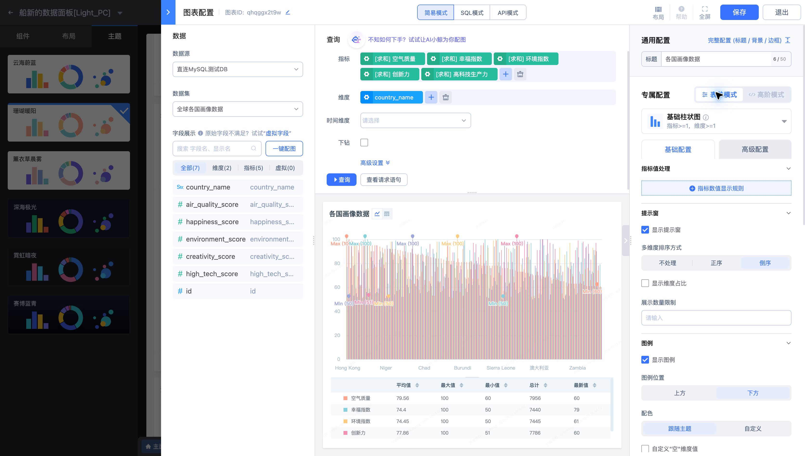

# 5. 在仪表盘内配置图表

继续使用 **船新的数据面板[Light_PC] → 全球各国画像数据**，以已有“各国画像数据”图表说明配置。新建仪表盘时可照此配置一张基础柱状图。

## 配置数据

1. 进入仪表盘编辑页，添加“基础柱状图”，或选择已有图表后单击编辑图标。
2. 选择“简易模式”，数据源选择“直连MySQL测试DB”，数据集选择“全球各国画像数据”。
3. 在指标添加五个分数字段：空气质量、幸福指数、环境、创新力、高科技，聚合方式使用示例中的求和。
4. 维度选择 `country_name`，单击“查询”。
5. 检查国家标签和每个指标的数值；有重复国家记录时，核对求和是否符合业务口径。

## 配置展示

设置清晰的标题、图例和提示窗，检查纵轴范围及单位。多个不同单位的指标不宜直接共用同一数值轴；本例为分值对比。

保存图表后调整画布中的位置与尺寸，预览整张仪表盘。确认无误再发布。

下一步：[6. 验证结果与分发](6.Verify-and-distribute.md)。
