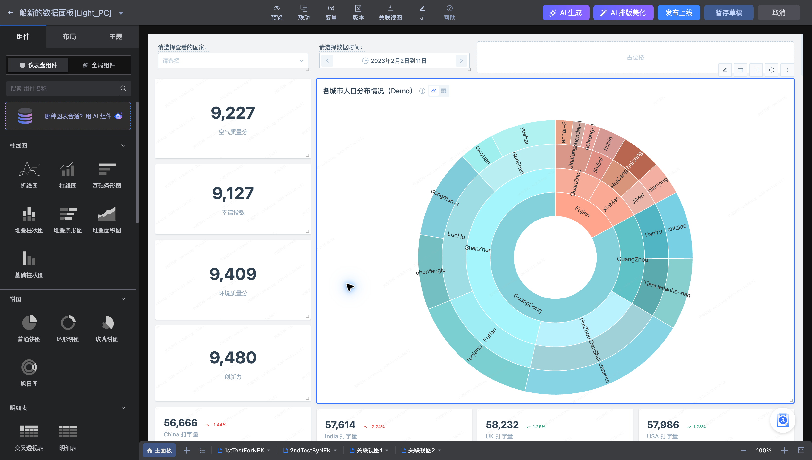
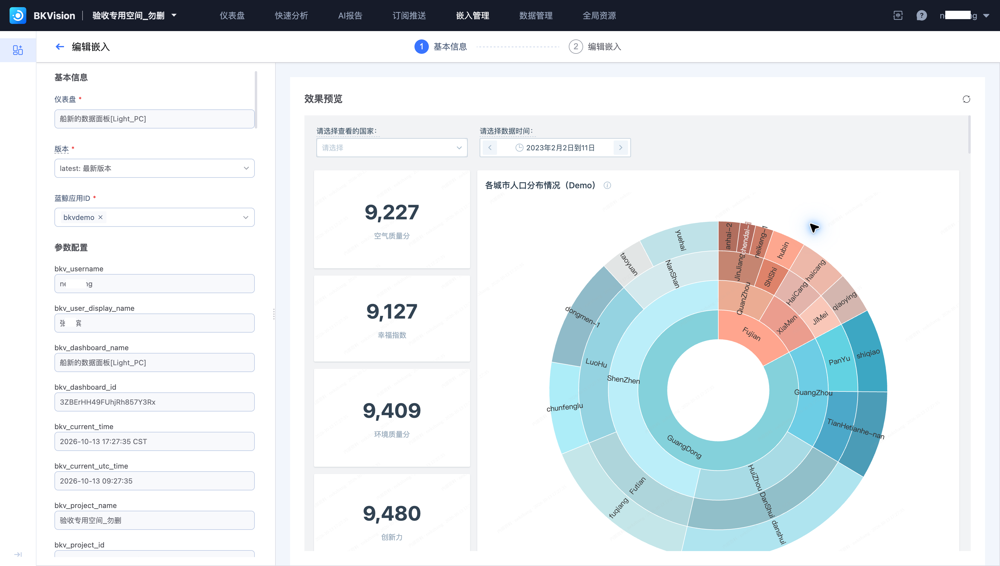

# 6. 验证结果与分发

国家画像图表配置完成后，按“数据 → 查询 → 图表 → 仪表盘”逐层验证，再选择消费入口。

## 验证并发布

| 检查项 | 验证方法 |
| --- | --- |
| 数据口径 | 核对 `country_info` 的记录粒度、国家范围和五个分值字段 |
| 查询结果 | 比较图表查询输出与同条件的数据样本 |
| 展示 | 检查国家标签、图例、单位、数值和空值 |
| 交互 | 修改筛选值后检查查询是否刷新；清除筛选后再核对 |
| 发布 | 预览通过后发布上线，重新打开正式浏览页 |

“暂存草稿”保留编辑进度；发布后再检查正式浏览页，不以草稿预览代替发布结果。

## 在 SaaS 中查看

已有 **船新的数据面板[Light_PC] / bkvdemo** 嵌入项可复用。按[嵌入管理](../Features/Embedded-management/Embedded-management.md)配置代码与变量，并在目标应用验证。

需要定时收到图片时，按[订阅配置](../Features/Subscrible-to-push/Subscription-configuration.md)建立对应仪表盘的任务，检查参数和接收人后测试。该功能页的既有订阅示例推送“BKOM数据”，应为当前看板另选或新建对应任务。
