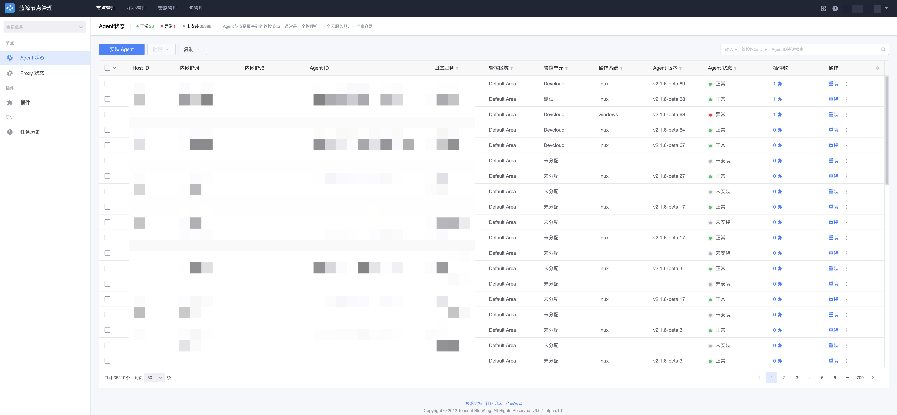
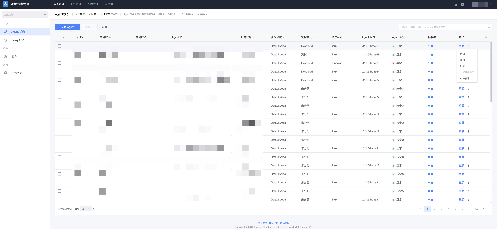

# Agent 管理

当目标主机与蓝鲸管控面网络可达（或已通过 Proxy 桥接）时，填写主机、端口、密码/密钥等信息即可安装 Agent。Agent 节点是最基础的管控节点，通常是一个物理机、一个云服务器、一个富容器。

## Agent 状态查询

进入「节点管理 → Agent 状态」页面，会显示当前账户有查询权限的所有 Agent 状态，支持按业务、管控区域、IP、操作系统、状态等属性进行筛选。

## 安装 Agent

点击「安装 Agent」，填写安装参数（安装到业务、管控区域/管控单元、IP 地址、登录 IP、操作系统、登录端口、登录账户、认证方式等）后即可开始安装。详细步骤请参考快速入门：

- [安装 Agent（直连管控单元）](../QuickStart/DirectUnitInstallAgent.md)
- [安装 Agent（自定义管控区域）](../QuickStart/CustomCloudAreaInstallAgent.md)

> 安装时会按「管控区域 + 内网 IP」校验主机是否已存在，已存在的主机会被忽略并给出提示。主机所属的 CMDB 管控区域必须与所选管控单元所属区域一致。

## Agent 维护

Agent 安装以后，日常的维护操作包含：

| 操作 | 说明 |
| --- | --- |
| 重装 | 在目标主机上重新安装 Agent。 |
| 升级 | 将 Agent 升级到指定版本。升级包经 GSE 文件通道推送，命令经 GSE 下发，不经 SSH 登录目标机。 |
| 重载（Reconfig） | 触发 installer 重新渲染配置并回写执行状态，用于接入点、配置策略等配置变更后的生效。重载会重启节点服务，请安排合适的操作时间。 |
| 重启 | 重启 Agent 进程，结果以 GSE Agent 状态轮询确认为准。 |
| 卸载 | 卸载目标主机上的 Agent。 |
| 移除 | 将主机从节点管理中移除。 |
| 分配管控单元 | 调整主机所属的管控单元。 |
| 带外管理 | 维护主机的带外管理信息。 |

在列表中选择目标主机，点击对应操作即可执行，任务进度可在「任务历史」中查看。

## Proxy 状态

「节点管理 → Proxy 状态」页面用于查看各管控单元下 Proxy 节点的运行状态。Proxy 节点用于收敛策略、桥接不同管控单元之间的 Agent 节点，同样支持升级、重载、重启、卸载等维护操作。

> Proxy 的升级与重载固定经由本机 Relay 回调回写状态；卸载 Proxy 前需要确认没有 Agent 与其连接。
