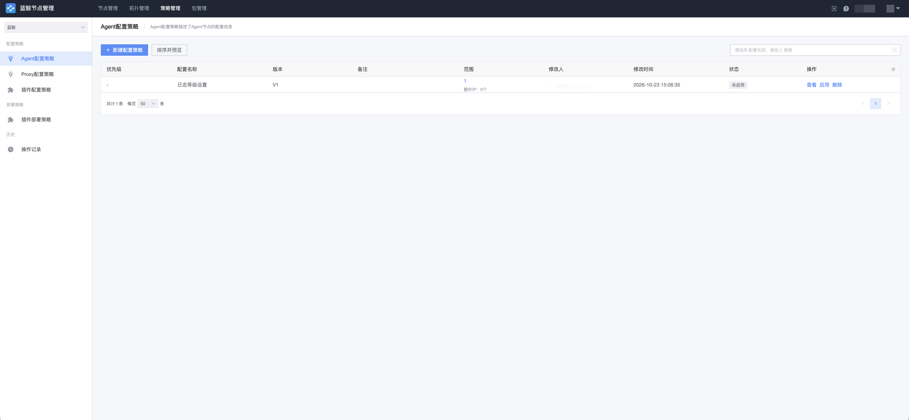

# 配置策略

配置策略用于按条件组合自定义节点配置并编排下发，是管理员维护的通用配置能力，分为 Agent 配置策略、Proxy 配置策略和插件配置策略三类。

## Agent 配置策略

Agent 配置策略描述了 Agent 节点的配置信息。例如通过 `logger_path`（日志存储路径）选项控制 Agent 进程日志文件的输出目录。配置项默认不下发，启用并填入值后才会随策略一起下发；配置策略下发后，在下一次 Agent 上报心跳或触发重载（Reconfig）时由 installer 重新渲染配置生效，不需要重启主机。

## Proxy 配置策略

Proxy 配置策略描述了 Proxy 节点的配置信息。例如通过 `all_logger_path` 一次性覆盖 Proxy 节点上 Agent、file、data 三类进程的日志存储目录，通过 `all_logger_level` 覆盖日志等级。

## 插件配置策略

插件配置策略描述了插件节点的配置信息和安装规则，用于对插件进程的配置进行统一下发与管理。

## 生效方式

配置策略的变更不会立即更新已有节点：策略下发后，通过节点的重载（Reconfig）动作由 installer 重新渲染配置并回写执行状态。重载会重启节点服务，请安排合适的操作时间，并在「任务历史」中确认任务成功。

策略操作的历史可在「配置策略 → 操作记录」页面查询。
