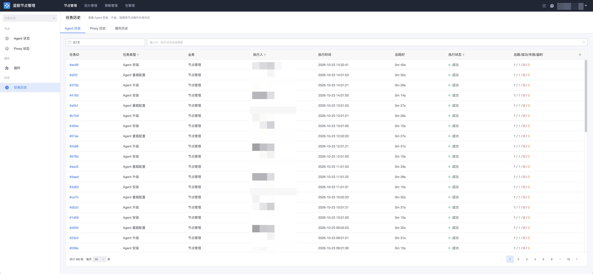
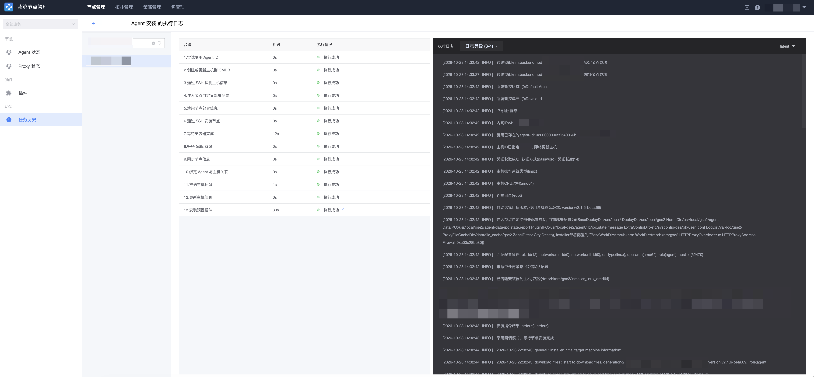

# 任务历史

节点管理的安装、升级、重载、重启、卸载等任务均为异步执行、耗时较长的工作流。「任务历史」用于查询这些节点操作任务的状态和执行日志。

## 查看任务历史列表

进入「节点管理 → 任务历史」页面，可查看 Agent、Proxy、插件相关的操作任务列表，通常可按业务、执行人、任务类型、状态等条件筛选。

## 任务详情与日志

点击单个任务，可以查看任务详情，包含当前任务下每个子任务（每台主机）的执行状态。再次点击单台主机，即可进入日志详情，查看该子任务的实时执行日志，定位失败原因。

## 其他操作记录

除节点任务历史外，以下模块也提供独立的操作记录页面：

- 「拓扑 → 操作记录」：拓扑（管控区域、管控单元、接入点等）操作的历史记录；
- 「部署策略 / 配置策略 → 操作记录」：策略操作的历史记录；
- 「包管理 → 操作记录」：包管理操作的历史记录。
