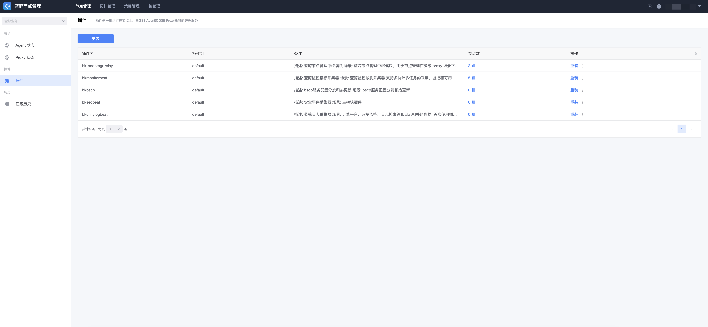
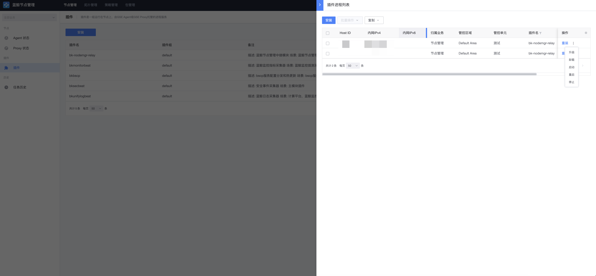
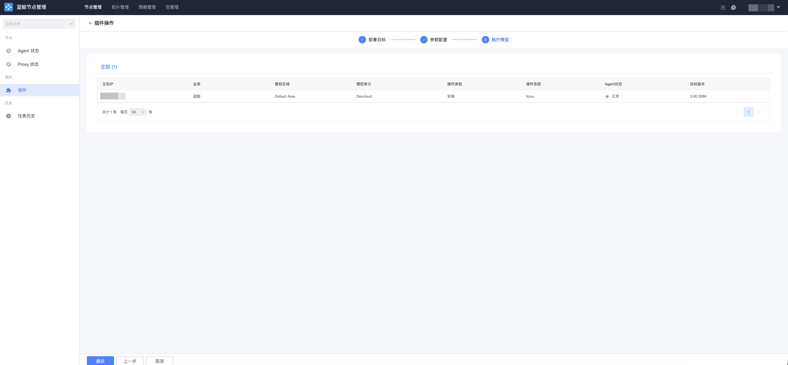
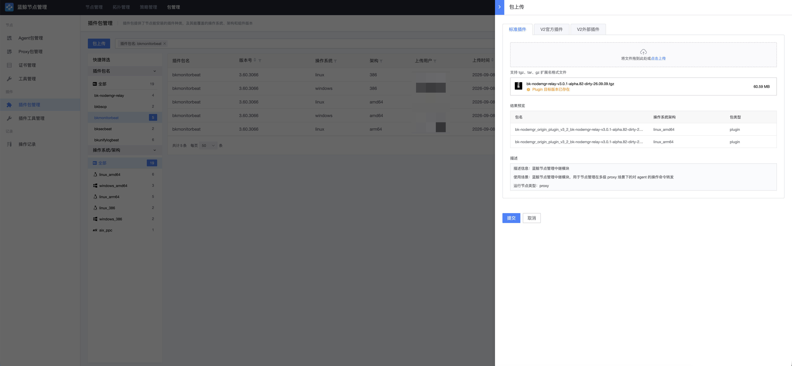

# 插件管理

插件是一组运行在节点上、由 GSE Agent 或 GSE Proxy 托管的进程服务。您可以通过插件管理功能部署并管理这些插件，或者导入更多第三方插件。

## 概念区分

| 概念 | 说明 |
| --- | --- |
| 插件包（Package） | 静态资源，有明确版本，全局共享；提供节点能安装的插件种类及其覆盖的操作系统、架构和组件版本。 |
| 插件（Plugin） | 业务概念，按租户隔离，同一租户下唯一，本身不携带版本。 |
| 进程（Process） | 插件在主机上的运行实例，有生命周期；每台主机上同一插件只能拥有一个进程实例。 |

## 插件状态查询

进入「节点管理 → 插件」页面，可以按指定条件查询当前主机上各个插件的运行状态和版本信息。

## 插件维护和安装

选中需要管理的主机，点击「插件操作」，在弹出的窗口中选择需要进行的操作和插件。对插件的维护包含以下操作：

- **安装/更新**：安装或更新插件程序；
- **启动**：启动插件进程；
- **停止**：停止插件进程；
- **重启**：重启插件程序，需插件支持；
- **重载**：通常用于配置更新，需插件支持；
- **托管**：将插件注册至 GSE Agent 进行管理，若插件进程异常退出，GSE Agent 会尝试将插件自动拉起；
- **取消托管**：取消插件的 GSE Agent 管理，插件异常退出时将不再被自动拉起。

## 部署策略

除了手动维护，您还可以使用「部署策略」实现插件的自动化部署管理。部署策略以声明式方式定义插件在目标节点上的期望部署状态，由两部分组成：

- **目标范围（scope）**：策略覆盖的目标，支持动态拓扑（topo）、集群模板（set_template）、服务模板（service_template）、实例（instance）、动态分组（dynamic_group）等选择方式，目标类型支持主机（host）和服务实例（service_instance）。
- **期望状态（spec）**：期望目标达到的状态，例如 `specify_plugin`（确保目标主机上安装指定名称和版本的插件，不存在则安装、版本不匹配则升级）、指定插件子配置 / 子配置模板（仅更新配置）等。

被目标范围覆盖的节点，将按照部署策略定义的规则自动进行插件的部署安装。

### 策略冲突与抑制

当多个部署策略命中同一目标时，将产生策略抑制效果，最终有且仅有一条部署策略生效：先创建的策略优先。

> 注：若目标主机上的插件版本与策略版本不一致，部署策略会将目标主机覆盖更新为策略版本。目标主机被部署策略管控后，手动方式的插件管理以策略定义为准。

### 安装插件

在「节点管理 → 插件」页面选中目标主机，通过插件页面的安装操作进行插件部署：

1. 选择需要安装的插件；
2. 选择插件版本——系统会根据所选主机的操作系统、CPU 架构信息自动匹配对应的插件包，存在多个可用版本时可手动选择；
3. 参数配置——部分插件包支持自定义参数配置；
4. 执行预览——确认所有主机与操作无误后执行安装。

### 编辑与停用部署策略

对于已有的部署策略，可以调整目标范围、部署的插件版本、插件包参数等属性。

通过策略的「停用」功能可以暂停策略的自动行为；停用后仍可通过「启用」重新开启策略。停用是控制策略是否参与计算，不表示要求删除已部署的目标。

## 添加新的插件包到节点管理

**第 1 步：获取插件包**

您可以通过蓝鲸官网的 [Smart 市场](https://bk.tencent.com/s-mart/) 获取插件包，或通过插件开发框架自定义开发插件。

**第 2 步：上传插件包**

进入「包管理 → 插件包管理」页面，点击「导入插件」，选择或拖入待导入的插件包，待系统解析成功后完成上传。

**第 3 步：启用插件包版本**

插件包版本包含两个相互独立的属性：

- **启用状态（enabled）**：控制包是否可被安装、重装、升级等流程使用；只有启用的版本才能被部署到主机上；
- **可见状态（is_hidden）**：控制插件包是否在前端选择列表中展示，仅用于展示筛选，不影响业务可用性。

在插件包详情页面中启用目标版本后，即可在插件操作或部署策略中选择使用。
