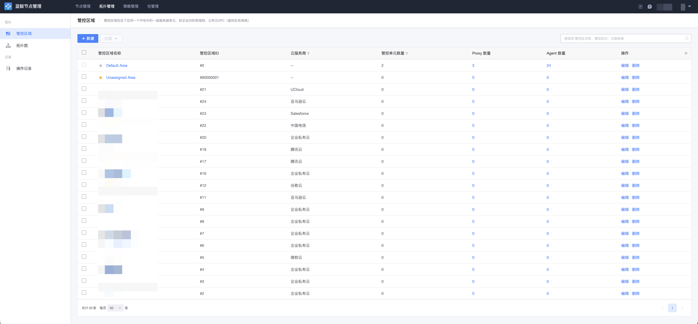
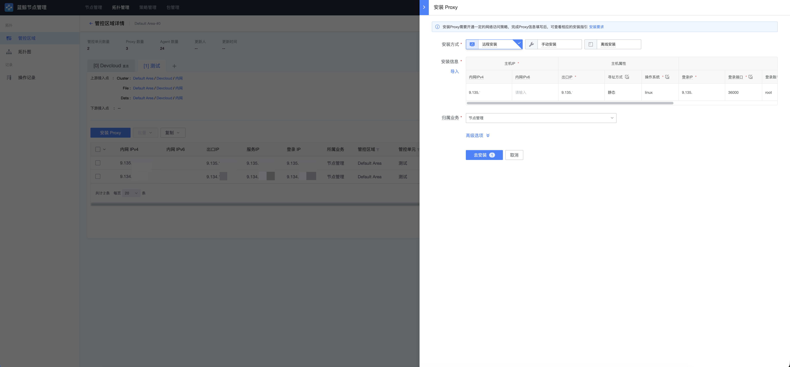

# 拓扑管理（管控区域）

管控区域是互相之间能直接通信的一组服务器单元所处的网络范围，如企业内的局域网、公有云 VPC（虚拟私有网络），对应 CMDB 中的管控区域（云区域）。

蓝鲸初始部署时包含默认管控区域（ID 为 0）。当主机与蓝鲸管控面网络直连时，使用默认区域下的直连管控单元即可；如果企业网络有区域划分（办公网与生产网隔离、总公司与分公司隔离、国内外网络隔离等），可根据实际网络连通性规划创建多个管控区域。

## 概念关系

| 概念 | 回答的问题 |
| --- | --- |
| 管控区域 | 主机属于哪个网络范围？ |
| 管控单元 | 这些节点通过什么路径接受管理：直连 GSE，还是经过 Proxy？ |
| 接入点 | 其他管控单元通过哪些地址连接到这里？ |

**区域描述网络归属，单元描述管理路径，接入点描述单元之间的连接地址。** 一个管控区域可以包含多个管控单元；同一区域内划分多个单元不能解决主机内网 IP 重复的问题。

## 查看管控区域

进入「拓扑 → 管控区域」页面，可以查看当前已经存在的管控区域及其下的管控单元。

## 创建管控区域

点击「新建」创建管控区域，填写区域名称、云服务商等信息。创建成功后，区域会同步到 CMDB。

> 创建区域只建立归属信息，不会自动建立 Proxy、配置接入点或打通网络。开始安装前，仍需准备好管控单元所需的服务和网络连通条件。

## 创建管控单元

在区域下创建管控单元，填写名称并选择类型：

| 类型 | Agent 的连接路径 | 需要配置 | Proxy 要求 |
| --- | --- | --- | --- |
| 直连单元 | Agent 直接连接 GSE。 | 直连配置中的 cluster、file、data 三组 GSE 地址。 | 不使用 Proxy，不能在其中安装 Proxy。 |
| 非直连单元 | Agent 连接本单元的 Proxy，Proxy 再连接上游。 | 选择上游管控区域、上游管控单元和接入点。 | 需要运行正常的 Proxy 提供控制、文件和数据通道。 |

单元创建后，所属区域和直连类型不能通过编辑切换。

## 安装 Proxy

非直连单元需要先具备可用的 Proxy。空单元中的第一台 Proxy 需要通过**跨单元安装**或**离线安装**建立；具备安装能力（即存在安装了 Relay 插件且运行正常的 Proxy）后，才能通过本单元继续安装 Agent 和其他 Proxy。

Proxy 安装参数说明：

- 内网 IP：与单元内 Agent 进行网络通讯的 IP。**首个内网 IP 必须是同单元内 Agent / Proxy 能访问的真实内网地址**，它将作为 Relay 服务的监听与回调地址；
- 出口 IP：Proxy 与上游 GSE 服务通信时的出口地址，常见于公网或 NAT 场景；
- 登录 IP：从安装源可以 SSH 登录到此 Proxy 主机的 IP，可选，默认使用内网 IP；
- 操作系统：作为 Proxy 的主机必须为 Linux 系统；
- 登录端口 / 登录账号 / 认证方式：SSH 连接信息，支持密码或密钥；
- 归属业务：Proxy 安装完成后录入到 CMDB 的哪个业务下，需要具备对应业务权限。

一个管控单元中可以安装多个 Proxy，以达到更高的可用性与负载均衡。

## 接入点管理

接入点是管控单元上配置的一组带名称的 GSE 接入地址（cluster 信令、file 文件、data 数据三组通道），供其他管控单元的 Proxy 连接使用。同一个单元面向不同网络时可以配置多个接入点，下游单元选择自己能够访问的那个。

> 接入点只记录地址，不会自动建立路由、NAT 或防火墙规则；修改接入点或上游选择后，已有节点不会立即更新配置，需要重载对应的 Agent 或 Proxy。

## 拓扑图

「拓扑 → 拓扑图」页面展示了管控单元之间的链路连接关系，可用于整体把握各区域的管控路径。

## 卸载 Proxy 与删除管控区域

- 卸载 Proxy 前需要确认当前 Proxy 没有 Agent 与其连接，否则会导致失败；
- 删除管控区域前需要先确认该区域下的 Proxy 已完全卸载。
