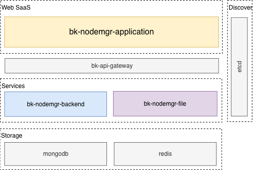
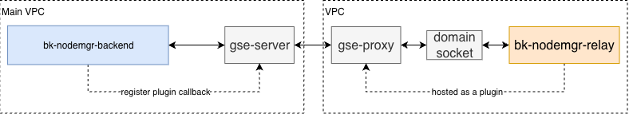
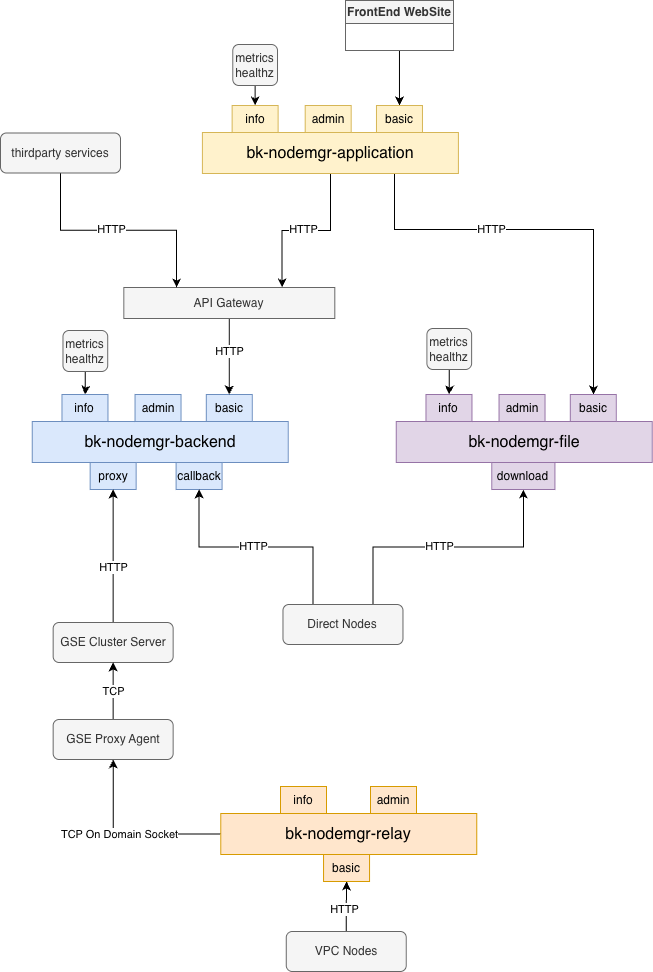

# 产品架构

## 基本模块构成

节点管理服务层由 3 个基本模块构成：

- **bk-nodemgr-application**：SaaS 服务，提供基础产品页面、用户登录等功能服务，无状态，可横向扩展。可以部署在蓝鲸 PaaS 平台上，或通过 Helm / docker-compose 直接部署。
- **bk-nodemgr-backend**：后端主服务模块，提供数据管理、流程执行等功能服务，无状态，可横向扩展。
- **bk-nodemgr-file**：后端文件服务模块，提供上传、下载等文件管理服务，无状态，可横向扩展。

节点安装依赖 SSH（Linux/macOS）或 WMI（Windows）通道触发目标主机上的 installer 执行安装；安装过程中的文件分发与状态回写，根据节点所在管控单元的拓扑，经由 Server 或 Proxy 上的 Relay 插件完成。

## 跨网络管理

管理非直连管控单元的节点时，节点管理会在 gse-proxy 所在的节点上托管一组插件 `bk-nodemgr-relay`，作为常驻服务提供对该单元节点的管理功能。通信上，Relay 与 Proxy 节点的 Agent 通过 domain socket 通信，依赖 GSE 的上下行信令通道实现跨网络通信。

如果企业需要管理不同网络区域的主机，只需要在目标区域提供 Linux 主机作为代理（Proxy）节点，同单元内其他主机只需和 Proxy 通信即可实现跨网络管理。

## 服务端口

### Application

- `info`：提供 metrics 和 healthz 信息，一般不对外暴露。
- `admin`：提供内部管理功能，一般不对外暴露。
- `basic`：基础前端服务端口，对外暴露。

### Backend

- `info`：提供 metrics 和 healthz 信息，一般不对外暴露。
- `admin`：提供内部管理功能，一般不对外暴露。
- `basic`：提供基础功能，一般经过 APIGW 对外暴露。
- `callback`：提供节点回调服务，暴露给直连的节点。
- `proxy`：提供代理服务，暴露给 GSE-Cluster。

### File

- `info`：提供 metrics 和 healthz 信息，一般不对外暴露。
- `admin`：提供内部管理功能，一般不对外暴露。
- `basic`：提供基础功能，对外暴露。
- `download`：提供下载服务，暴露给直连的节点。

### Relay

- `info`：提供 metrics 和 healthz 信息，一般不对外暴露。
- `admin`：提供内部管理功能，一般不对外暴露。
- `basic`：提供 `backend/callback` + `file/download` 的组合服务，暴露给当前网络单元下的节点。
