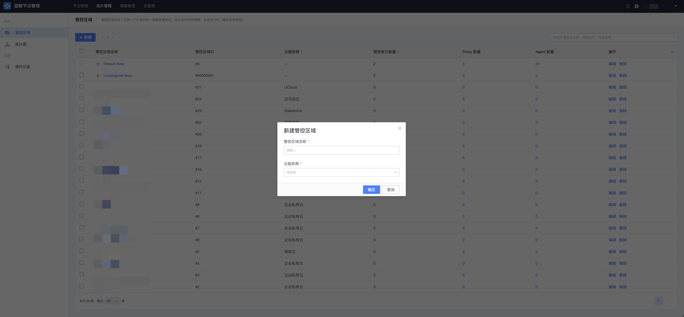
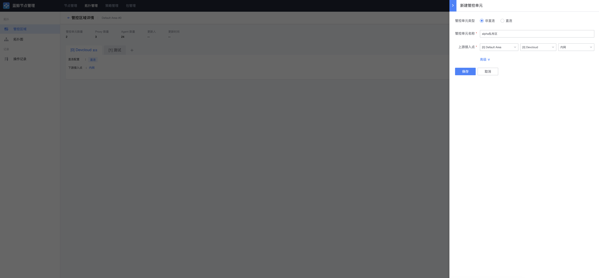
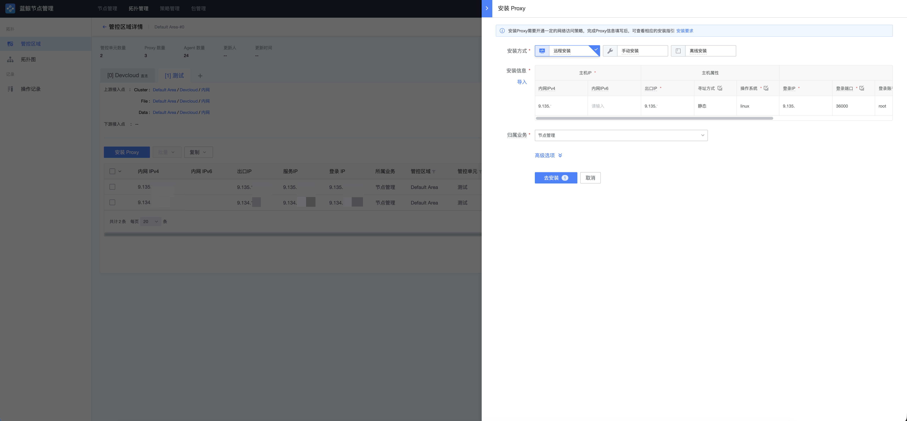
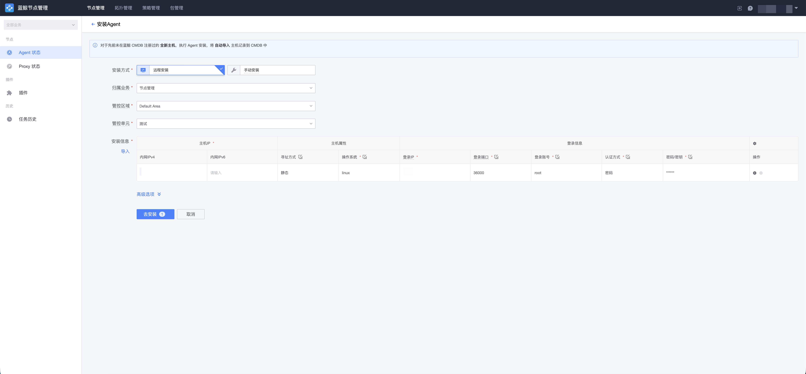
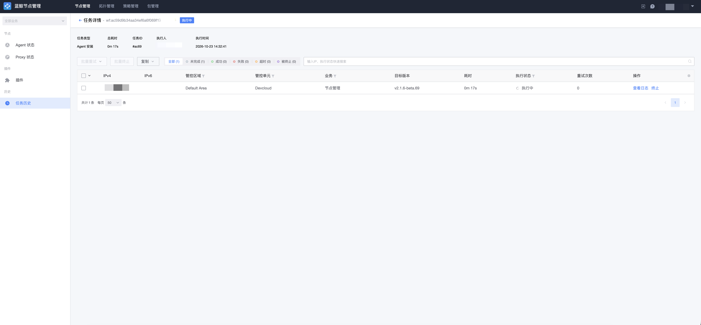

# 安装 Agent（自定义管控区域）

适用场景：目标主机所在网络与蓝鲸管控面隔离，蓝鲸无法直接访问目标主机。此时需要通过创建自定义管控区域、非直连管控单元并安装 Proxy 的方式，桥接管控该区域内的主机。

## 步骤一：创建管控区域

进入「拓扑 → 管控区域」页面，点击「新建」创建管控区域，填写区域名称、云服务商等信息。创建成功后，区域会同步到 CMDB。

> 创建区域只建立归属信息，不会自动建立 Proxy 或打通网络。

## 步骤二：创建非直连管控单元

在刚创建的管控区域下新建管控单元，类型选择「非直连」，并选择上游管控区域、上游管控单元和接入点（即 Proxy 向上游通信所使用的 cluster / file / data 通道地址）。

## 步骤三：安装 Proxy

非直连单元需要先具备可用的 Proxy 才能继续安装 Agent。空单元中的第一台 Proxy 需要通过以下方式建立：

- **跨单元安装**：从其他已具备安装能力的管控单元（如默认区域的直连单元）发起，向目标 Proxy 主机远程安装；
- **离线安装**：目标环境完全无法访问管控面网络时，手动下载离线包在目标主机上执行安装。

按照页面指引填写 Proxy 安装参数（内网 IP、出口 IP、登录 IP、认证方式、归属业务等），点击安装并等待任务成功。

> 注意：Proxy 主机必须为 Linux 系统；Proxy 的首个内网 IP 必须是同单元内 Agent / Proxy 可访问的真实内网地址，它将作为 Relay 服务的监听与回调地址。

## 步骤四：安装 Agent

Proxy 安装成功后，进入「节点管理 → Agent 状态」页面，点击「安装 Agent」，管控区域 / 管控单元选择刚创建的非直连单元，补全目标主机详情后点击「安装」。

此时安装任务由单元内 Proxy 上的 Relay 插件作为操作源执行：目标节点从 Relay 拉取安装包，并向 Relay 回写执行状态。

## 步骤五：查看执行状态

提交后会自动跳转到任务页面，等待 Agent 安装完成。如果任务失败，可以点击对应主机查看安装日志定位问题。

