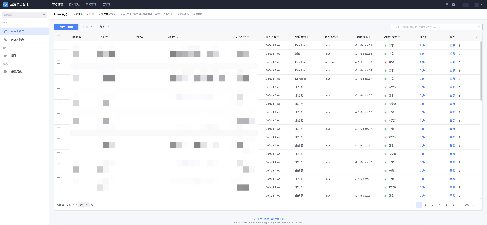
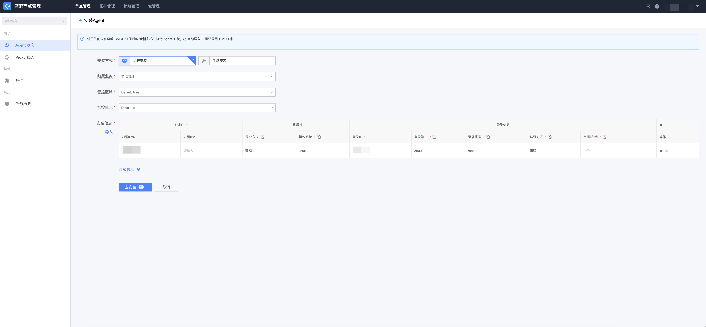
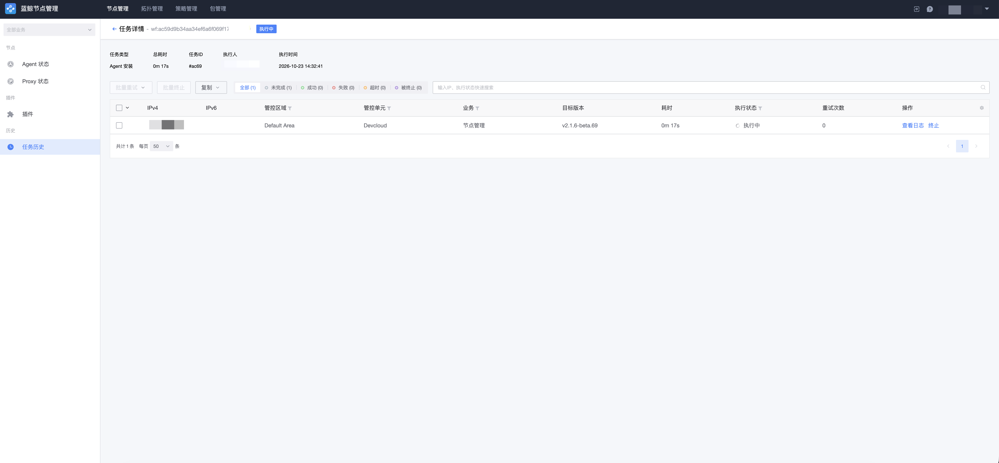

# 安装 Agent（直连管控单元）

适用场景：目标主机与蓝鲸管控面网络可达，可以直接连接 GSE 服务。此时选择默认管控区域（ID 为 0）下的直连管控单元安装 Agent 即可。

## 前置条件

- 目标主机的 SSH（Linux/macOS）或 WMI（Windows）登录通道可用，安装时需要提供登录账户与认证信息（密码或密钥）。
- 目标主机可以访问节点管理 File 服务的 `download` 下载地址与 Backend 的 `callback` 回调地址（在线安装时，目标节点从 File 拉取安装包并向 Backend 回写状态）。
- 直连管控单元已配置可用的 GSE 直连地址（cluster / file / data 三组通道）。

## 步骤一：开始安装 Agent

进入「节点管理 → Agent 状态」页面，点击「安装 Agent」按钮。

## 步骤二：填写安装参数

- **安装到业务**：主机安装 Agent 后，需指定录入到蓝鲸配置平台（CMDB）的哪个业务。
- **管控区域 / 管控单元**：选择默认管控区域下的直连管控单元。
- **安装信息**：
    - IP 地址：主机的内网 IP 地址；
    - 登录 IP：安装时登录目标主机使用的地址，通常与内网 IP 一致，不一致时才需要单独填写；
    - 操作系统：主机的操作系统类型（linux / windows / darwin），不同系统登录方式有差异，请务必填写正确；
    - 登录端口：通常 SSH 登录端口为 22（Windows 为 WMI 端口）；
    - 登录账户：Linux/macOS 请使用 root 账户，Windows 请使用 Administrator；
    - 认证方式：支持密码和密钥两种方式。

确认无误后点击「安装」，开始执行安装任务。

## 步骤三：查看执行状态

提交后会自动跳转到任务页面，等待 Agent 安装完成。如果任务失败，可以点击对应主机查看安装日志定位问题。

> 除在线自动安装外，也可以选择手动安装：由系统生成引导命令，管理员复制到目标主机上手动执行完成安装。
